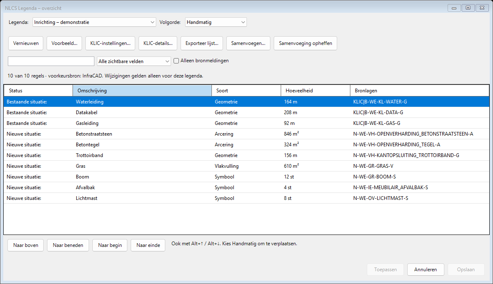
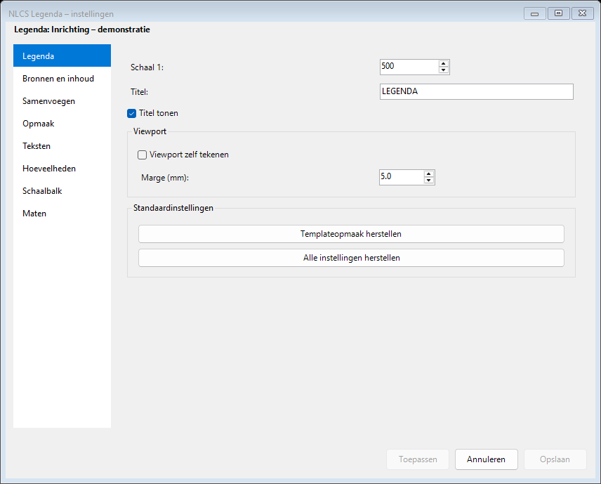

# NLCS Legenda

Maak een legenda van de NLCS-lagen in je AutoCAD- of Civil 3D-tekening.
De plugin neemt lijnen, arceringen en symbolen over, voegt omschrijvingen en
desgewenst hoeveelheden toe, en werkt de legenda bij wanneer het ontwerp verandert.

**[Download de installer](https://github.com/joligej/infracad-helper/releases/latest)**
· [Installeren](docs/installatie.md) · [Handleiding](docs/handleiding.md)
· [Problemen oplossen](docs/problemen-oplossen.md)

*Het echte venster Overzicht, gevuld met openbare demonstratiegegevens.*

## Beginnen

1. Installeer de MSI uit de laatste release en herstart AutoCAD of Civil 3D.
2. Open een tekening met NLCS-lagen en kies **NLCS Legenda → Genereren**.
3. Kies de hele tekening of een selectie, stel de schaal in en plaats de legenda.
4. Gebruik **Lokale instellingen** voor deze legenda en **Bijwerken** na bronwijzigingen.

Typen kan ook: begin met `NLCSLEGENDA`. **Help** in het lint bevat de basisuitleg.

## Wat je kunt aanpassen

| Onderdeel | Mogelijkheden |
| --- | --- |
| Inhoud | Regels en kleurvarianten kiezen, door lagen zoeken, objecten aanklikken om uit te sluiten |
| Volgorde en teksten | Handmatig ordenen, samenvoegen met een hoofdobject, eigen omschrijvingen en statussen |
| Opmaak | Schaal, maten, kolommen, notities, hoeveelheden, schaalbalk en passende symbolen |
| Voorbeelden | Bronweergave of een volledig voorbeeld uit een DWG-bibliotheek |
| Xrefs | Bronnen en lagen doorzoeken en kiezen, ook bij geneste of alleen-lezen bronnen |
| KLIC | Netbeheerders en objectgegevens lezen; onder meer diameters apart houden of samenvoegen |
| Uitvoer | Een gekoppelde viewport die de legenda-schaal volgt, CSV/JSON of een uittrekstaat van een map |

Elke legenda bewaart haar eigen bron en instellingen in de DWG. **Toepassen**
werkt de gekozen legenda meteen bij; **Opslaan** past wijzigingen toe en sluit het
venster. Na Toepassen blijven beide knoppen uitgeschakeld totdat er weer iets wijzigt.
**Bijwerken** bewaart uitgevinkte regels en eigen instellingen; **Resetten** begint
weer met de globale standaard. Samenvoegkeuzes voor KLIC en overige lagen staan
naast elkaar, met optioneel de samengevoegde waarden in de omschrijving.
De **Globale standaard** geldt voor nieuwe legenda’s. Met **Profielen** kun je
een opzet bewaren en delen.

## Voor gebruik in een project

- **Modelruimte in meters.** Papiermaten worden omgerekend met de gekozen schaal.
  Symbolen behouden standaard hun modelmaat; passend maken en het samenvoegen van
  grootte-, rotatie- en attribuutvarianten zijn apart instelbaar.
- **Bibliotheek en lettertype.** Bedrijfseigen voorbeelden en `NLCS-ISO.ttf` zitten
  niet in de installer. Neem je eigen bibliotheek mee naar een andere computer.
- **Hoeveelheden.** Een niet meetbaar bronoppervlak verschijnt als `? m²`, met een
  bronmelding. De plugin controleert geen werkelijke ligging van kabels en leidingen.
- **KLIC-host.** Civil 3D/Map leest Object Data uit de hoofdtekening en directe of
  geneste xrefs. Ook ingebedde InfraCAD-gegevens en leesbare Property Sets tellen mee.

De [handleiding](docs/handleiding.md) beschrijft keuzes en commando’s.
[Maatvoering](docs/template-maatvoering.md) legt de opmaak vast;
[KLIC-gegevens](docs/klic-bronnen.md) licht bronkeuze en groepering toe.
[Prestatiemetingen](docs/prestaties.md) toont de gemeten doorlooptijden en beperkingen.

## Compatibiliteit en onderhoud

Windows, 64-bit, AutoCAD/Civil 3D **2025, 2026 en 2027**. De bundles worden apart
gebouwd voor elke jaargang. CAD-acceptatie vindt lokaal plaats op 2025 en 2027;
2026 wordt gebouwd maar is hier niet als host beschikbaar.

De plugin werkt lokaal, zonder account of telemetrie. Dit is een onafhankelijk
project; het wordt niet uitgegeven door Autodesk of InfraCAD.

[Wijzigingen per versie](CHANGELOG.md) · [Bijdragen en testen](CONTRIBUTING.md)
· [Bug melden](https://github.com/joligej/infracad-helper/issues/new?template=bug_report.yml)
· [Beveiliging](SECURITY.md) · [Ontwikkelrichtingen](docs/ontwikkelrichtingen.md)

## Licentie

[MIT](LICENSE).
