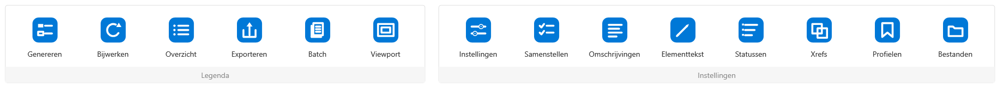

# NLCS Legenda

[](https://github.com/joligej/infracad-helper/actions/workflows/ci.yml)
[](https://github.com/joligej/infracad-helper/releases/latest)
[](LICENSE)

Voor een NLCS-tekening teken je de legenda meestal met de hand: voor elk element
een blokje, de juiste arcering erin en de tekst ernaast. Dat werk neemt deze plugin
over. Hij leest de InfraCAD/NLCS-lagen die al in je Civil 3D- of AutoCAD-tekening
zitten en zet daar de bijbehorende legenda bij, in dezelfde stijl.



## Zo werkt het

Start `NLCSLEGENDA`. Je kunt eerst nog de schaal of een paar opties zetten; daarna
hangt de legenda aan je cursor en zet je hem naast de tekening neer. Standaard maakt hij
een legenda van de hele tekening; kies je in het optiemenu `Uitkiezen`, dan komt er een
legenda van alleen die selectie. Alles komt in de model space op de eigen NLCS-lagen, dus
kleur en lijntype kloppen meteen. Wie liever klikt dan typt vindt
in het lint een tab **NLCS Legenda** met dezelfde functies. Via **Help** in het lint staat
de basisuitleg ook in AutoCAD zelf.

### Meerdere legenda's

Je kunt meerdere legenda's naast elkaar in één tekening hebben, bijvoorbeeld één voor de
hele tekening en aparte legenda's voor deelgebieden. Elke legenda onthoudt zijn eigen
bron (hele tekening of selectie) en zijn eigen instellingen. `NLCSLEGENDABEHEER` toont de
legenda's en laat je ze bijwerken, hernoemen, opzoeken (zoomen) en verwijderen. In
hetzelfde venster pas je per gekozen legenda de instellingen aan (de legenda wordt daarna
in dezelfde bewerking opnieuw opgebouwd), neem je de instellingen over van een andere
legenda, dupliceer je een legenda, wijzig je de bronselectie of zet je de opmaak van die
legenda als globale standaard voor nieuwe legenda's.

### Bijwerken en viewport

Is het ontwerp veranderd, dan tekent `NLCSLEGENDAUPDATE` de legenda opnieuw op precies
dezelfde plek. Omdat een beheerde legenda bij bijwerken volledig opnieuw wordt opgebouwd,
verdwijnen rechtstreekse wijzigingen die je met de hand in de legenda hebt gemaakt; pas de
tekst daarom aan via de instellingen of `NLCSLEGENDATEKST`. Is er één legenda, dan gaat dat
direct; bij meerdere klik je de gewenste legenda aan (of kies je uit een lijst). Een
selectielegenda wordt daarbij opnieuw van diezelfde selectie opgebouwd, niet van de hele
tekening. `NLCSLEGENDAVIEWPORT` maakt in
de paper space een viewport rond de gekozen legenda op de ingestelde schaal.

### Instellingen

De globale instellingen zijn het startpunt voor een **nieuwe** legenda. Zet je later de
globale standaard anders, dan verandert een bestaande legenda niet mee: die houdt de
instellingen waarmee hij is gemaakt. Bij één aanwezige legenda openen de instelcommando's direct die legenda. Bij meerdere
klik je de gewenste legenda aan of kies je uit een lijst. Gewiste legenda's tellen niet
mee; Undo maakt ze weer bereikbaar. Zonder legenda bewerk je de globale standaard.
De knop **Standaard** (`NLCSLEGENDASTANDAARD`) opent die standaard ook als er al legenda's
zijn. De instellingen van één bestaande legenda bewerk je ook via `NLCSLEGENDABEHEER`.
Het instellingenvenster bundelt alles in tabbladen: naast schaal, inhoud, opmaak, teksten,
hoeveelheden en schaalbalk zitten daar ook de per-xref keuze, de eigen statussen inclusief
ledentoewijzing en de omschrijvingen. De losse commando's blijven als snelkoppeling bestaan.
De omschrijvingen bewerk je met `NLCSLEGENDAOMSCHRIJVINGEN`, en `NLCSLEGENDATEKST` past de
tekst van één aangeklikt element aan. Een nieuwe legenda wordt standaard als één blok
geplaatst; met *Exploderen bij plaatsen* kies je losse entiteiten.

Weet je niet zeker waarom een element niet in de legenda staat? `NLCSLEGENDAELEMENT` laat
je een object aanwijzen en meldt of en waarom het wel of niet in de gekozen legenda komt
(status, discipline, hoofdgroep, elementsoort, xref, zichtbaarheid of uitgevinkt).

De teksten volgen de NLCS-template: tekststijl `NLCS-ISO` met standaardhoogtes (2,5 mm voor
regels en statuskoppen, 5 mm voor de titel) op de tekstlagen `-T25` en `-T50`. Alle tekst
in de legenda bestaat uit gewone MText-objecten, zodat je die in AutoCAD net als andere tekst
kunt selecteren en bewerken. De teksthoogtes zijn per legenda instelbaar.
De standaard statuskoppen zijn "Nieuwe situatie:", "Bestaande situatie:", "Vervallen situatie:",
"Tijdelijke situatie:" en "Revisie"; je kunt ze in de instellingen aanpassen.

Onder de legenda staan standaard de tekeningnotities, een schaalbalk en de schaaltekst.
De schaalbalk heeft vier segmenten van elk 10 mm op papier, met afwisselende halve
vullingen. Teksten en onderdelen kun je aanpassen of uitzetten. In het opmerkingenvenster
kies je tussen tekeningnotities en de KLIC-waarschuwing.

De legenda is bedoeld voor modelruimte in meters. Papiermaten worden eenmaal met de
gekozen schaal omgerekend. Symbolen behouden hun modelmaat; een expliciete NLCS-schaalvariant
wordt naar de gekozen schaal omgerekend. Grote symbolen krijgen meer rij- en kolomruimte.
De hulpkaders zijn in modelruimte zichtbaar en worden niet geplot; een buitenkader staat
standaard uit. Een lege tekststijl kiest `NLCS-ISO` met lettertype `NLCS-ISO.ttf`. Ontbreekt dat lettertype, installeer
het of kies in Instellingen een bestaande tekststijl.

Bestaande legenda's houden hun opgeslagen instellingen. Kies **Opmaak → template** om
de maatvoering bij te werken. Eigen teksten, bronnen, filters en de gekozen schaal blijven
behouden. De standaardmaatvoering staat in [Maatvoering](docs/template-maatvoering.md).

`NLCSLEGENDAEXPORT` schrijft de regels van de huidige tekening weg als CSV en JSON.
Wil je een hele projectmap in één keer, dan leest `NLCSLEGENDABATCH` elke DWG in een
gekozen map (zonder ze te openen of te wijzigen) en zet alles in één uittrekstaat met
een kolom *Tekening*; een tekening die niet leesbaar is, wordt overgeslagen en gemeld.

Niet elke NLCS-laag hoeft in de legenda. Met `NLCSLEGENDAUITVINKEN` klik je een
element aan om die regel weg te laten (of weer terug te zetten). Heb je een eigen laag
die er juist wél bij hoort, dan maak je met `NLCSLEGENDATOEVOEGEN` een regel aan: je
kiest het type (lijn, vlak, arcering, vlakvulling of symbool), de laag en de
omschrijving. In `NLCSLEGENDABEHEER` staat dit bij elkaar in één venster. Het uitvinken
en de eigen regels horen bij de globale standaard of bij één legenda.

### Eigen lagen

Heb je eigen (niet-NLCS) lagen die als echte bron moeten meetellen, dan koppel je die in
het instellingenvenster onder *Eigen lagen*. Je kiest de laag, het type en de hoeveelheid
(lengte, aantal of oppervlak), en de legenda leest de echte geometrie van die laag. Je kiest
ook de bron: alleen de hoofdtekening, elke meegenomen bron, of één specifieke xref. Zit
dezelfde laagnaam in de host én in een xref, dan houdt de bron ze uit elkaar. Eigen lagen
werken daarna hetzelfde als NLCS-lagen, ook voor hoeveelheden en xrefs. Anders dan een
handmatige regel verschijnt een eigen laag alleen als er echt objecten op staan. Je koppelt
alleen de lagen die je zelf aanwijst; hulp- en annotatielagen blijven buiten beeld.

### Blanco regels

Wil je bewust lege ruimte in de legenda reserveren, bijvoorbeeld om er later met de hand
iets bij te tekenen, gebruik dan *Blanco regels* in het instellingenvenster. Een blanco
regel is een statische, lege regel (leeg vakje, standaardtekst "[blanco]") zonder bron en
zonder hoeveelheid. Je kunt er meerdere toevoegen; elke regel blijft los bestaan en
behouden bij bijwerken, opslaan en heropenen. De tekst en status zijn per regel aan te passen.

Je kunt ook per elementsoort kiezen wat in de legenda komt: geometrie/lijnen, vlakken,
arceringen, vlakvullingen en symbolen zijn afzonderlijk aan of uit te zetten. Standaard
staat alles aan. Je vindt dit in `NLCSLEGENDAOPTIES` onder *Elementsoorten* en in het
keuzemenu vóór het plaatsen. `NLCSLEGENDAINFO` meldt welke soorten uitstaan.

### KLIC-tekeningen

Voor KLIC-tekeningen (kabels en leidingen) kun je regels samenvoegen op een eigenschap.
Onder *Groepering* in de instellingen zet je los aan of je samenvoegt op soort, spanning/druk,
uitvoering (mantelbuis/hulpstuk) of volgnummer. Zo worden bijvoorbeeld DATA, DATA2 en DATA3
één regel, of hoog- en laagspanning samen. De hoeveelheden tellen op en het is omkeerbaar:
zet je de groepering uit, dan staat elke laag weer apart. Generieke placeholdertekst uit
KLIC-symbolen (zoals "TYPE \ LABEL \ OMSCHRIJVING") wordt standaard weggelaten; echte tekst
blijft staan.

Onder *Groepering* staat ook *Gelijke statussen samenvoegen*. Die voegt dezelfde regel uit
verschillende statussen samen, maar alleen als lijn, vlak, arcering en symbool er precies
hetzelfde uitzien. Standaard staat dit uit, omdat de status in NLCS meestal juist de kleur
bepaalt.

De keuzelijst bij Samenstellen volgt de bron van de gekozen legenda. Uitgevinkte
regels blijven uitgevinkt als hun bron tijdelijk ontbreekt. Instellingen en
beschrijvingen die je vóór het plaatsen aanpast, gelden alleen voor die nieuwe legenda.
Gebruik Standaard om de instellingen voor nieuwe legenda's te wijzigen.

### Statussen, xrefs en profielen

Naast de vaste statussen (Nieuw, Bestaand, Vervallen, Tijdelijk, Revisie) maak je met
`NLCSLEGENDASTATUS` eigen statussen aan. Daar wijs je regels aan toe: automatische
NLCS-lagen door ze in de tekening aan te wijzen, handmatige regels via een lijstje. Zo'n
regel verschijnt dan onder de eigen kopregel, ook als de gewone status ervan uitstaat.

Werk je met externe referenties, dan bepaalt `NLCSLEGENDAXREFS` per gekoppelde xref of
die meetelt. De keuze geldt voor de aanwezige of gekozen legenda. Voor nieuwe
legenda's pas je de xref-keuze aan onder Standaard. Is het xref-bestand op schijf gewijzigd sinds het laden, herlaad dan eerst de
xref voordat je de legenda bijwerkt. Zo blijven hoeveelheden en voorbeelden op dezelfde
bronversie gebaseerd; bij een versieverschil blijft de bestaande legenda behouden.

Een arceringspatroon dat in het bronvlak ongelijk is geschaald, past niet in één
patroonhoek en schaal. De plugin meldt dit en breekt het maken of bijwerken af.
Een afwijkende schaal loodrecht op het vlak is wel toegestaan.

Heb je een legenda-opzet die je vaker gebruikt, dan bewaar je die met `NLCSLEGENDAPRESET`
als profiel. Je laadt het profiel in een bestaande legenda of als globale standaard. Zo
hoef je schaal, teksten en opmaak niet telkens opnieuw in te stellen. Een profiel kun je
ook exporteren naar een `.json`-bestand en op een andere computer weer importeren, zodat je
een opzet met collega's kunt delen.

| Commando | Doet |
|----------|------|
| `NLCSLEGENDA` | Legenda genereren en met de muis plaatsen (hele tekening of selectie). |
| `NLCSLEGENDAUPDATE` | Een legenda opnieuw tekenen op dezelfde plek; bij meerdere kies je welke. |
| `NLCSLEGENDABEHEER` | Legenda's bekijken, bijwerken, hernoemen, opzoeken, verwijderen, en per legenda instellingen aanpassen, overnemen, dupliceren of de bron wijzigen. |
| `NLCSLEGENDAELEMENT` | Klik een object aan en zie of en waarom het in de gekozen legenda komt. |
| `NLCSLEGENDAINFO` | Tonen wat erin zou komen (aantallen, lengtes, oppervlakten, totalen per hoofdgroep) en welke regels nog een eigen omschrijving missen, zonder te tekenen. |
| `NLCSLEGENDAEXPORT` | De regels wegschrijven als CSV en JSON, met hoeveelheden en de herkomst van elke omschrijving. |
| `NLCSLEGENDABATCH` | Alle DWG's in een map samen in één uittrekstaat (CSV/JSON) met een kolom Tekening. |
| `NLCSLEGENDAVIEWPORT` | Een viewport in de huidige layout rond de legenda, op schaal. |
| `NLCSLEGENDAOPTIES` | Alle instellingen bewerken in een venster met normale tabbladen (schaal, inhoud, opmaak, teksten). |
| `NLCSLEGENDASTANDAARD` | De instellingen voor nieuwe legenda's bewerken. |
| `NLCSLEGENDAOMSCHRIJVINGEN` | De omschrijvingen per element bewerken in een tabel. |
| `NLCSLEGENDATEKST` | Klik een element aan en pas de tekst ervan aan (meerdere regels mogelijk). |
| `NLCSLEGENDASAMENSTELLEN` | Regels uitvinken en eigen regels toevoegen in één venster. |
| `NLCSLEGENDAUITVINKEN` | Klik een element aan om die regel uit de legenda te laten. |
| `NLCSLEGENDATOEVOEGEN` | Een eigen regel toevoegen (type, laag en omschrijving zelf kiezen). |
| `NLCSLEGENDASTATUS` | Eigen statussen maken en er regels aan toewijzen (naast Nieuw/Bestaand/...). |
| `NLCSLEGENDALAAGNAAM` | Een NLCS-laagnaam component voor component bewerken en de laag hernoemen. |
| `NLCSLEGENDAXREFS` | Per gekoppelde xref kiezen of die in de legenda wordt meegenomen. |
| `NLCSLEGENDAPRESET` | Instellingen van de globale standaard of een gekozen legenda als profiel opslaan, laden, en im-/exporteren. |
| `NLCSLEGENDACONFIG` | De globale configuratiebestanden aanmaken en de paden tonen. |

## Headless gebruik (Core Console)

De meeste commando's zijn bedoeld voor AutoCAD/Civil 3D met venster. In de AutoCAD Core
Console (`accoreconsole.exe`, zonder venster) werken de commando's die geen muis of dialoog
nodig hebben: `NLCSLEGENDAINFO`, `NLCSLEGENDAEXPORT` en `NLCSLEGENDAUPDATE`. Een
venster-commando (zoals `NLCSLEGENDA`, `NLCSLEGENDABEHEER` of `NLCSLEGENDAVIEWPORT`) weigert
in de Core Console netjes en wijzigt niets.

`NLCSLEGENDAUPDATE` en `NLCSLEGENDAEXPORT` kiezen headless automatisch de legenda als er maar
één is. Zijn er meerdere, kies er dan één via de omgevingsvariabele `NLCSLEGENDA_TARGET`
(een legenda-id of een unieke naam) vóór het starten van de Core Console; zonder die keuze
weigeren ze veilig in plaats van een object te vragen.

## Installatie

Er zijn twee manieren, allebei bij de [releases](https://github.com/joligej/infracad-helper/releases).

**Met de installer (aanbevolen).** Download `NlcsLegenda-X.Y.Z.msi` en voer die uit.
De installer zet de plugin per gebruiker neer in `%APPDATA%\Autodesk\ApplicationPlugins`
(geen beheerdersrechten nodig), staat daarna in Windows bij *Apps* om te de-installeren,
en bevat één bestand dat voor 2025, 2026 én 2027 werkt. Start Civil 3D of AutoCAD daarna
opnieuw.

De installer is self-signed ondertekend als `joligej`. Die handtekening laat zien dat
het bestand na ondertekening niet is gewijzigd; hij zegt niets over een door een externe
autoriteit geverifieerde identiteit. Windows toont pas een vertrouwde uitgever als je het
meegeleverde `joligej-codesign.cer` zelf importeert. Doe dat alleen als je dit certificaat
vertrouwt: een certificaat in *Vertrouwde basiscertificeringsinstanties* geldt voor je hele
gebruikersprofiel. Zonder import werkt de installer gewoon, maar staat er "onbekende
uitgever". Een download controleer je met `SHA256SUMS.txt` bij de release.

**Handmatig (zip).** Download `NlcsLegenda-2027-vX.Y.Z.zip` (of de 2025-/2026-variant),
pak de map `NlcsLegenda.bundle` uit in `%APPDATA%\Autodesk\ApplicationPlugins\` en start
Civil 3D of AutoCAD opnieuw. De bundle bestaat uit twee dll's die bij elkaar horen.

Aan het ontwikkelen? Bouw met `dotnet build -c Release` en laad de gebouwde
`NlcsLegenda.dll` met `NETLOAD`. Voor 2027 geef je `-p:AcadVersion=2027` mee; dat is
.NET 10 en de dll belandt in `bin\Release\net10.0-windows`. 2025 en 2026 zijn .NET 8
(`bin\Release\net8.0-windows`).

## Welke lagen worden opgepakt

Alleen op basis van de laagnaam. Een NLCS-laag ziet er zo uit:
`N-WE-VH-OPENVERHARDING_BETONSTRAATSTEEN-A`. Het eerste teken is de status (N voor
nieuw, B voor bestaand, V voor vervallen, enzovoort); de rest beschrijft het element
en het tekentype: lijn, arcering of symbool. De volledige opbouw staat in
[docs/NLCS-conventies.md](docs/NLCS-conventies.md).

Een eigen omschrijving van de legenda krijgt voorrang. Daarna gebruikt de plugin de
omschrijving uit de tekening: bij een KLIC-symbool eerst het ingevulde attribuut
`OMSCHRIJVING`, anders de laagbeschrijving. Ontbreekt die, dan volgen de ingebouwde
catalogus en ten slotte een leesbare laagnaam. Eigen laagkoppelingen gebruiken de tekst
uit hun koppeling. Er is geen koppeling met InfraCAD of een externe database.
`NLCSLEGENDAINFO` laat zien welke regels op de laagnaam terugvallen, zodat je gericht een
eigen omschrijving kunt toevoegen.

Een omschrijving heeft een algemeen en een specifiek deel, bijvoorbeeld "Verharding"
en "Betonstraatsteen". Standaard toont de legenda alleen het specifieke deel; met de
optie `Algemeen` (of `includeGeneralDescription`) zet je het algemene deel ervoor.

## Configuratie

`NLCSLEGENDAOPTIES` laat je een bestaande legenda of de globale standaard kiezen.
Instellingen van een bestaande legenda worden in die tekening bewaard en gelden alleen
voor die legenda. Via `NLCSLEGENDABEHEER` kun je ze ook bewerken of als nieuwe globale
standaard opslaan.

De globale standaard staat in `%APPDATA%\NlcsLegenda\settings.json`, los van de plugin
zelf: de dll's staan in `ApplicationPlugins` (vaak alleen-lezen) en je instellingen bij je
profiel. `NLCSLEGENDACONFIG` maakt dat bestand aan en toont de paden. Een voorbeeld staat
in [deploy/settings.sample.json](deploy/settings.sample.json); wat je weglaat krijgt de
standaardwaarde.

`NLCSLEGENDAOMSCHRIJVINGEN` laat dezelfde keuze tussen een legenda en de globale standaard toe. Globale omschrijvingen staan in
`%APPDATA%\NlcsLegenda\omschrijvingen.json`. Een voorbeeld staat in
[deploy/omschrijvingen.sample.json](deploy/omschrijvingen.sample.json). De eigen omschrijvingen van een legenda worden in de tekening bewaard; je kunt ze ook via `NLCSLEGENDABEHEER` bewerken.

## Bouwen en testen

Je hebt de .NET SDK nodig (versie 8 voor AutoCAD 2025 en 2026, versie 10 voor 2027).
AutoCAD hoeft er niet op te staan om te bouwen. Lokale builds en CI gebruiken standaard
dezelfde `AutoCAD.NET`-referenties van NuGet. Met `-p:UseNuGetAcad=false` kun je expliciet
tegen lokaal geïnstalleerde hostassemblies bouwen, mits hun .NET-versie bij het doelframework past.

```powershell
dotnet build NlcsLegenda.slnx -c Release
dotnet test NlcsLegenda.slnx
```

Het ontleden van laagnamen, groeperen en de opmaak zitten in `NlcsLegenda.Core`, los
van AutoCAD, en zijn dus met `dotnet test` te controleren. Wil je de hele plugin op
een echte tekening draaien, dan doet `dev/scripts/Run-HeadlessLegendTest.ps1` dat
headless via de AutoCAD Core Console. `dev/scripts/Run-IntegrationTests.ps1` draait
plaatsen, overzicht, export en bijwerken achter elkaar en controleert de resultaten.

Voor een release draait `dev/scripts/Run-ReleaseAcceptance.ps1` afzonderlijke synthetische
tekeningen voor stijlen, xrefs, symbolen, arceringen, eigen lagen, plaatsing en oudere
legenda's. Het script controleert de geladen DLL-hash, echte QSAVE, heropenen, vijftig
updates en ongewijzigde systeemvariabelen. Het stopt bij een fout of ontbrekend testresultaat.
Gebruik `-AcadVersion 2027` voor de 2027-host en `-PluginPath <geïnstalleerde DLL>` voor
acceptatie na installatie. De runners vereisen PowerShell 7.4 of nieuwer; sluit AutoCAD
en wacht tot andere Core Console-taken klaar zijn. Ze controleren ook de opgeslagen
profielwaarden. Logs en resultaten blijven lokaal onder `artifacts/acceptance/`.

## Ondersteunde versies

AutoCAD/Civil 3D 2025, 2026 en 2027 (64-bit). De plugin bouwt op .NET 8 voor 2025/2026 en
op .NET 10 voor 2027. De .NET 8-build laadt zowel op de oudere .NET 8-hosts (2025 t/m
Update 1.3, 2026 t/m Update 1.1) als op de nieuwere .NET 10-hosts (2025.1.4+, 2026.1.2+),
zodat één installatie alle updates dekt. Getest op AutoCAD 2025 (Update 1.4, .NET 10) en
2027.1 (.NET 10). Werk Autodesk-producten en object enablers op dezelfde machine samen bij
naar hun .NET 10-versie; dat is Autodesk-advies, los van deze plugin.

## Beperkingen

De ingebouwde teksten dekken de gangbare elementen. Voor de rest valt de plugin
terug op de laagbeschrijving of de laagnaam. Wil je een sluitende lijst, vul dan
`omschrijvingen.json` aan; `NLCSLEGENDAINFO` wijst aan welke regels nog terugvallen op
de laagnaam. De maatvoering rekent van papier-millimeters naar modeleenheden en gaat
uit van een tekening in meters (de gebruikelijke RD-eenheid); annotatieve schaal wordt
niet gebruikt.

## Licentie

MIT, zie [LICENSE](LICENSE).
