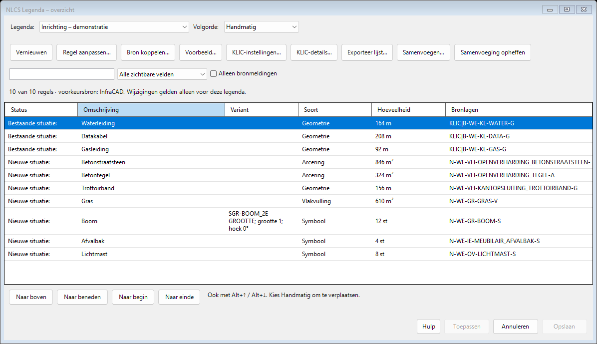
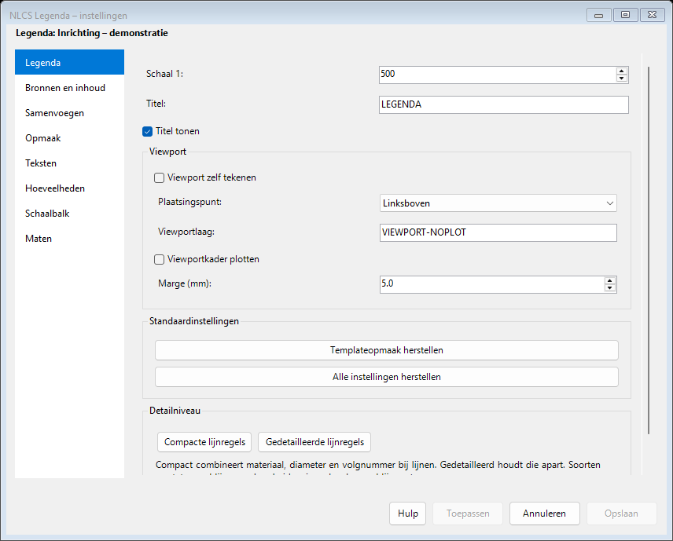

# NLCS Legenda

Maak een legenda van de NLCS-lagen in je AutoCAD- of Civil 3D-tekening.
De plug-in neemt lijnen, arceringen en symbolen over, voegt omschrijvingen en
desgewenst hoeveelheden toe, en werkt de legenda bij wanneer het ontwerp verandert.

**[Download de installer](https://github.com/joligej/infracad-helper/releases/latest)**
· [Installeren](docs/installatie.md) · [Handleiding](docs/handleiding.md)
· [Problemen oplossen](docs/problemen-oplossen.md)

*Overzicht met demonstratiegegevens.*

## Beginnen

1. Installeer de MSI uit de laatste release en herstart AutoCAD of Civil 3D.
2. Open een tekening met NLCS-lagen en kies **NLCS Legenda → Genereren**.
3. Kies de hele tekening of een selectie, stel de schaal in en plaats de legenda.
4. Gebruik **Lokale instellingen** voor deze legenda en **Bijwerken** na bronwijzigingen.

Nog geen brongegevens? Je kunt de lege legenda alvast plaatsen en daarna xrefs kiezen.
Met **Blanco** begin je bewust zonder automatische regels.

Typen kan ook: begin met `NLCSLEGENDA`. **Help** in het lint bevat de basisuitleg.

Nieuw met de plug-in? Begin bij [Je eerste legenda](docs/handleiding.md#eerste-legenda).
Werk je in een kaderbestand met xrefs, volg dan de
[stappen voor een kaderbestand](docs/handleiding.md#werken-in-een-kaderbestand-met-xrefs).

## Updates

Vanaf 1.42.0 meldt de plug-in bij opstarten een nieuwe stabiele release.
**Updates controleren** in het lint opent dezelfde controle handmatig.
Downloaden kan tijdens het werken. De installatie wacht totdat alle CAD-sessies
zijn gesloten. Start Civil 3D daarna opnieuw. Je kunt een versie overslaan of
de automatische controle uitschakelen. Zie [Bijwerken](docs/installatie.md#vanuit-de-plug-in).

## Wat je kunt aanpassen

| Onderdeel | Mogelijkheden |
| --- | --- |
| Kaartgebied | Kiezen welke kaartvensters meetellen en nagaan waarom een regel ontbreekt |
| Inhoud | Regels en kleurvarianten kiezen, door lagen zoeken, objecten aanklikken om uit te sluiten |
| Bijwerken | Goedgekeurde regels behouden, hun voorbeelden bijwerken en nieuwe onderdelen eerst als voorstel bekijken |
| Volgorde en teksten | Regels ordenen, omschrijvingen en statussen aanpassen en projectomschrijvingen delen |
| Opmaak | Schaal, maten, kolommen, notities, hoeveelheden, schaalbalk en passende symbolen |
| Voorbeelden | Een bronobject of Civil 3D-profielonderdeel koppelen en kiezen of het voorbeeld de bron volgt |
| Bladcontrole | Omschrijvingen en weergaven vergelijken, met bewaarde uitzonderingen |
| Xrefs | Bronnen en lagen doorzoeken en kiezen, ook bij geneste of alleen-lezen bronnen |
| Samenvoegen | Per soort voorbeeld bepalen welke verschillen meetellen, of zelf regels samenvoegen met een gekozen hoofdvoorbeeld |
| KLIC | Netbeheerders en objectgegevens lezen, afzonderlijke samenvoegkeuzes en alle bronwaarden bekijken |
| Uitvoer | De legenda op een layout plaatsen, tussen model en layout verplaatsen en hoeveelheden exporteren |

Elke legenda bewaart haar eigen bronnen en instellingen in de DWG.
**Lokale instellingen** verandert de gekozen legenda. De **Globale standaard**
geldt voor nieuwe legenda's. Met **Profielen** kun je een opzet bewaren en delen.

Gebruik **Bijwerken** na een wijziging aan het ontwerp. Uitgevinkte regels en
eigen keuzes blijven behouden. **Resetten** begint opnieuw met de globale
standaard. Kies die functie alleen als je de lokale keuzes wilt laten vervallen.

## Voor gebruik in een project

- **Modelruimte in meters.** Papiermaten worden omgerekend met de gekozen schaal.
  Symbolen behouden standaard hun modelmaat. Je kunt ze passend maken in het
  voorbeeldvak en apart instellen welke symboolvarianten worden samengevoegd.
- **Bibliotheek en lettertype.** Bedrijfseigen voorbeelden en `NLCS-ISO.ttf` zitten
  niet in de installer. Neem je eigen bibliotheek mee naar een andere computer.
- **Hoeveelheden.** Een niet meetbaar bronoppervlak verschijnt als `? m²`, met een
  bronmelding. De plug-in controleert niet waar kabels en leidingen werkelijk liggen.
- **KLIC-gegevens.** Civil 3D/Map leest Object Data uit de hoofdtekening en directe of
  geneste xrefs. Ook ingebedde InfraCAD-gegevens en leesbare Property Sets tellen mee.

In de [handleiding](docs/handleiding.md) staan de stappen per taak, met uitleg
en voorbeelden. Meer achtergrond vind je bij [Maatvoering](docs/template-maatvoering.md),
[KLIC-gegevens](docs/klic-bronnen.md) en [Prestatiemetingen](docs/prestaties.md).

## Compatibiliteit en onderhoud

Windows, 64-bit, AutoCAD/Civil 3D **2025, 2026 en 2027**. De bundles worden apart
gebouwd voor elke jaargang. De plug-in wordt in AutoCAD/Civil 3D 2025 en 2027
getest. De versie voor 2026 wordt wel gebouwd, maar dat programma is hier niet
beschikbaar voor gebruikstests.

De tekenverwerking werkt lokaal, zonder account of telemetrie. Alleen de
updatecontrole haalt openbare releasegegevens en gekozen downloads op bij GitHub.
Er worden geen tekeningen of projectgegevens verstuurd. Dit is een onafhankelijk
project. Het wordt niet uitgegeven door Autodesk of InfraCAD.

[Wijzigingen per versie](CHANGELOG.md) · [Bijdragen en testen](CONTRIBUTING.md)
· [Bug melden](https://github.com/joligej/infracad-helper/issues/new?template=bug_report.yml)
· [Beveiliging](SECURITY.md) · [Ontwikkelrichtingen](docs/ontwikkelrichtingen.md)

## Licentie

[MIT](LICENSE).
