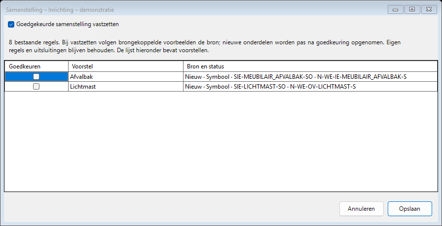
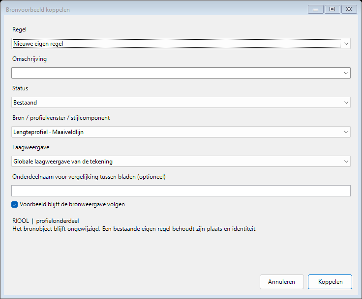
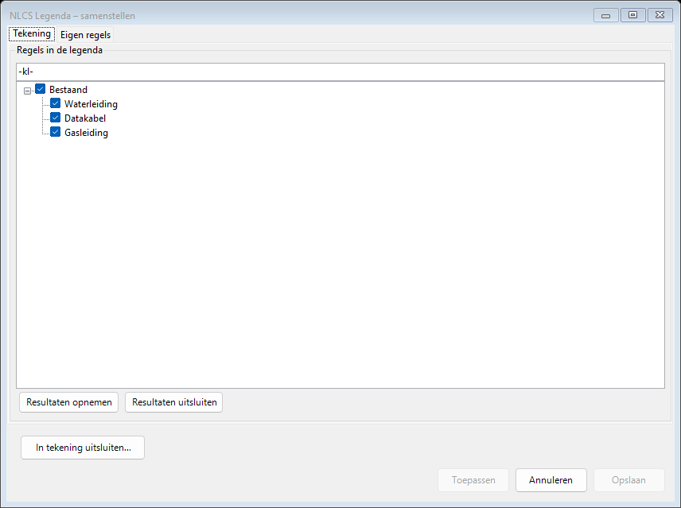
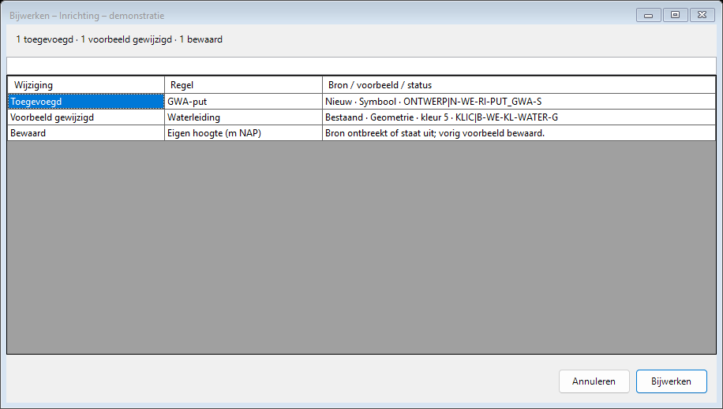
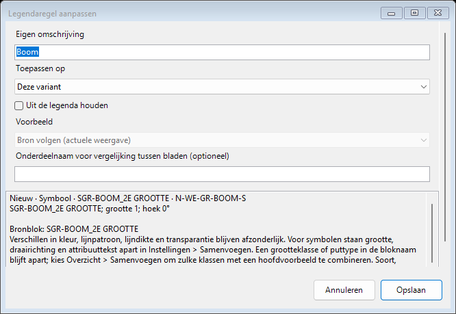
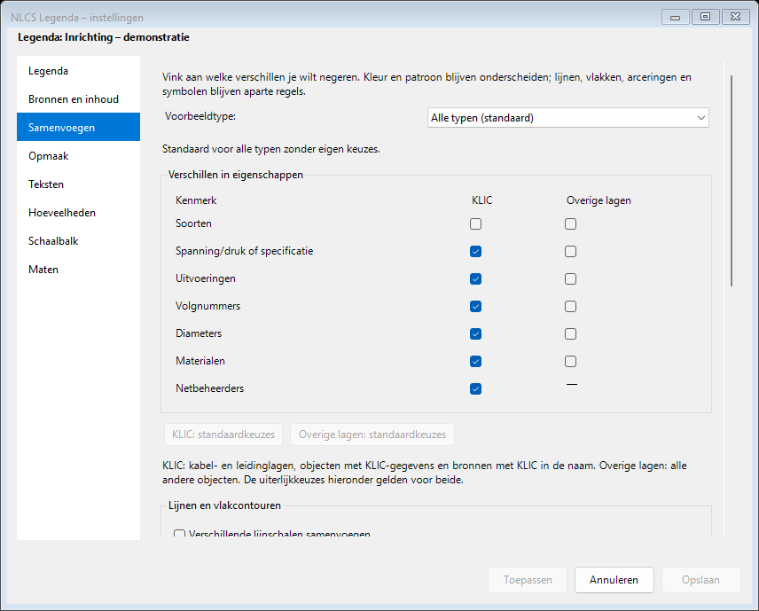

# Handleiding

[Installeren](installatie.md) · [Problemen oplossen](problemen-oplossen.md) · [Terug naar het project](../README.md)

## Eerste legenda

Start `NLCSLEGENDA`. Je kunt eerst nog de schaal of een paar opties zetten; daarna
hangt de legenda aan je cursor en zet je hem naast de tekening neer. Standaard maakt hij
een legenda van de hele tekening; kies je in het optiemenu `Uitkiezen`, dan komt er een
legenda van alleen die selectie. Alles komt in de model space op de eigen NLCS-lagen, dus
kleur en lijntype kloppen meteen. Wie liever klikt dan typt vindt
in het lint een tab **NLCS Legenda** met dezelfde functies. Via **Help** in het lint staat
de basisuitleg ook in AutoCAD zelf.

### Meerdere legenda's

Je kunt meerdere legenda's naast elkaar in één tekening hebben, bijvoorbeeld één voor de
hele tekening en aparte legenda's voor deelgebieden. Elke legenda onthoudt zijn eigen
bron (hele tekening of selectie) en zijn eigen instellingen. `NLCSLEGENDABEHEER` toont de
legenda's en laat je ze bijwerken, hernoemen, opzoeken (zoomen) en verwijderen. In
hetzelfde commando pas je per gekozen legenda de instellingen aan (de legenda wordt daarna
in dezelfde bewerking opnieuw opgebouwd), neem je de instellingen over van een andere
legenda, dupliceer je een legenda, wijzig je de bronselectie of zet je de opmaak van die
legenda als globale standaard voor nieuwe legenda's.

### Goedgekeurde samenstelling en gekoppelde voorbeelden

Gebruik versie 1.40 of hoger op alle werkplekken die deze nieuwe keuzes bewerken.
Oudere legenda's worden bij opslaan omgezet; oudere plug-ins kunnen de nieuwe
legenda-opslag niet bewerken, zodat vastgezette regels en bronkoppelingen beschermd blijven.

**Samenstelling vastzetten** (`NLCSLEGENDAVASTZETTEN`) bewaart de bestaande regels als
vaste lijst. Bijwerken houdt hun bronweergave actueel, maar voegt nieuwe onderdelen
alleen toe na goedkeuring in dit venster. Eigen regels die je zelf toevoegt zijn al
een bewuste keuze. Uitsluitingen en niet-plottende of verborgen bronlagen houden
voorrang. Uitzetten hervat het automatisch bepalen van de samenstelling; **Resetten**
wist de vaste samenstelling en begint met de globale standaard.

Bij een niet eenduidige splitsing blijft het vorige voorbeeld staan. Kies eerst in
**Overzicht → Bron koppelen** welk bronvoorbeeld die regel moet volgen. Keur daarna
gewenste extra regels goed. Zo worden oude en nieuwe varianten niet ongemerkt dubbel
opgenomen.

**Gekoppeld voorbeeld** (`NLCSLEGENDAVOORBEELDKOPPELEN`) laat je een bronobject
rechtstreeks aanwijzen, ook binnen een xref. Kies een nieuwe eigen regel of koppel
een bestaande eigen regel. De bestaande plaats, identiteit en uitsluitingen blijven
bewaard. Het bronobject blijft staan en wordt niet gewijzigd.

- **Bron volgen:** het voorbeeld wordt bij bijwerken opnieuw uit de gekoppelde bron
  opgebouwd. De actuele kleur, het lijntype, de lijndikte en transparantie tellen mee.
- **Voorbeeld vastzetten:** de huidige afbeelding blijft bewaard. Overzicht meldt
  verschillen met de gekoppelde bron per regel; een melding verandert het voorbeeld niet.
- **Laagweergave:** standaard de globale laagweergave van het kader, inclusief
  aangepaste xref- en KLIC-kleuren. Kies expliciet een kaartvenster om diens
  laagafwijkingen te gebruiken. Dit kiest de weergave van het voorbeeld; het verandert
  niet de bronselectie van de hele legenda.

Ook via **Overzicht → Regel aanpassen** kun je de bronmodus wijzigen. Een oude eigen
regel zonder bronkoppeling blijft een eigen voorbeeld. De plug-in leidt geen bron af
uit alleen de omschrijving: koppel die eenmaal zelf. Een legenda met uitsluitend
zulke regels krijgt geen onterechte melding dat er geen bronobjecten meer zijn.

Voor Civil 3D kies je bij het aanklikken van een profielonderdeel het profielvenster
en de zichtbare stijlcomponent: maaiveldlijn, rioolhartlijn, wanden, put of putarcering.
Stijloverschrijvingen in het profielvenster gaan vóór de basisstijl. Lijnen en wanden
worden schematisch weergegeven met hun echte stijl; putvormen komen uit het
profielonderdeel. Neem overige getekende markeringen, zoals een rode overlap bij een
kruising, als afzonderlijk gekoppeld bronobject op. De koppeling bewaart de gekozen
Civil 3D-component; er wordt geen riooltype afgeleid uit alleen zijn kleur.

### Verplaatsen en bladen vergelijken

**Naar model of layout** (`NLCSLEGENDAVERPLAATSEN`) plaatst de gekozen legenda in de
huidige modelruimte of papierlayout. Schakel eerst naar het gewenste tabblad; verlaat
een actief kaartvenster met `PSPACE`. Kies de legenda en haar nieuwe linkerbovenpunt.
Papiermaten, inhoud, volgorde en instellingen blijven behouden. Een eigen gekoppeld
legendavenster wordt verwijderd wanneer de legenda rechtstreeks naar papier gaat.
De bronkaartvensters blijven staan. In papierruimte vermeldt de voettekst
**Voorbeelden schematisch**; de kaart- en schaalbalkschaal blijft apart bewaard.

**Bladen vergelijken** (`NLCSLEGENDAVERGELIJKEN`) leest de legenda's in andere gekozen
DWG's zonder die bestanden te wijzigen. De controle vergelijkt dezelfde bronlaag,
objectsoort, symboolsoort en status. Voor eigen regels of verschillend benoemde bronnen
kun je een gedeelde **Onderdeelnaam voor vergelijking tussen bladen** invullen via
Regel aanpassen of Gekoppeld voorbeeld. Verschillende statussen blijven afzonderlijk.

De lijst toont afwijkende omschrijvingen en weergaven. Vink een bewuste uitzondering
aan en sla de keuze op. Die keuze blijft in de huidige tekening bewaard en wordt
opnieuw gevraagd zodra de betrokken tekst of weergave verandert. Regels zonder
bronkoppeling of gedeelde onderdeelnaam worden als niet vergeleken gemeld.

### Bijwerken en viewport

Is het ontwerp veranderd, dan tekent `NLCSLEGENDAUPDATE` de legenda opnieuw op precies
dezelfde plek. Instellingen, uitsluitingen en handmatige samenstellingen blijven bewaard
voor bestaande bronobjecten, ook na een kleur-, stijl- of schaalwijziging en na heropenen.
Vooraf verschijnt een overzicht van toegevoegde, verdwenen, gesplitste en samengevoegde
regels, gewijzigde voorbeelden en bronmeldingen. Annuleren laat de legenda staan.
Dit overzicht verschijnt ook bij Alles bijwerken. Nieuwe bronregels worden
volgens de opgeslagen filters toegevoegd. Ook een volledig uitgevinkte legenda blijft
beschikbaar om later weer aan te vullen.

**Resetten** (`NLCSLEGENDARESET`) vervangt na bevestiging de eigen instellingen en
samenstelling door de huidige globale standaard. Naam, bronselectie en plaats blijven
behouden; andere legenda's veranderen niet.

Omdat een beheerde legenda bij bijwerken volledig opnieuw wordt opgebouwd,
verdwijnen rechtstreekse wijzigingen die je met de hand in de legenda hebt gemaakt; pas de
tekst daarom aan via de instellingen of `NLCSLEGENDATEKST`. Is er één legenda, dan gaat dat
direct; bij meerdere klik je de gewenste legenda aan (of kies je uit een lijst). Een
selectielegenda wordt daarbij opnieuw van diezelfde selectie opgebouwd, niet van de hele
tekening. `NLCSLEGENDAVIEWPORT` maakt in
de paper space een viewport rond de gekozen legenda op de ingestelde schaal. Dit venster
blijft gekoppeld: bij een schaalwijziging van de legenda volgt de viewport automatisch en
blijft hij vergrendeld. Automatisch gemaakte kaders groeien mee; een handmatig getekend
kader houdt zijn papierafmetingen. De marge wordt zo nodig verkleind; een te klein
kader geeft een melding zonder de schaal te veranderen. Kies **Bestaand** om een oud legenda-venster eenmalig te
koppelen. Andere viewports worden niet aangepast.

Bij plaatsen wijs je standaard de **linkerbovenhoek** aan. Onder **Legenda → Viewport**
kun je kiezen voor het **middelpunt**. Bij automatisch vergroten blijft dat punt op zijn
plaats. Zowel getekende als automatisch geplaatste kaders komen standaard op
**VIEWPORT-NOPLOT**, met plotten uit. De laagnaam en plotinstelling zijn aanpasbaar;
de plotinstelling geldt voor alle objecten op die laag.

### Instellingen

De globale instellingen zijn het startpunt voor een **nieuwe** legenda. Wijzig je later de
globale standaard, dan verandert een bestaande legenda niet mee: die houdt de
instellingen waarmee hij is gemaakt. Bij één aanwezige legenda openen de instelcommando's direct die legenda. Bij meerdere
klik je de gewenste legenda aan of kies je uit een lijst. Gewiste legenda's tellen niet
mee; Undo maakt ze weer bereikbaar. **Lokale instellingen** (`NLCSLEGENDAOPTIES`) werkt
uitsluitend op een bestaande legenda. **Toepassen** tekent die legenda meteen opnieuw;
**Opslaan** doet hetzelfde en sluit het venster. Na **Toepassen** zijn beide opslagknoppen
uitgeschakeld totdat je iets wijzigt. **Annuleren** sluit het venster en laat reeds toegepaste
wijzigingen staan. Een fout houdt het venster open en
behoudt de vorige legenda en instellingen.
**Globale standaard** (`NLCSLEGENDASTANDAARD`) opent afzonderlijk de instellingen voor
nieuwe legenda's, ook wanneer er nog geen legenda in de tekening staat. De instellingen
van één bestaande legenda bewerk je ook via `NLCSLEGENDABEHEER`.
Het instellingenvenster heeft links een lijst met onderdelen: naast schaal, inhoud, opmaak, teksten,
hoeveelheden en schaalbalk zitten daar ook de per-xref keuze, de eigen statussen inclusief
ledentoewijzing en de omschrijvingen. De losse commando's blijven als snelkoppeling bestaan.
De omschrijvingen bewerk je met `NLCSLEGENDAOMSCHRIJVINGEN`, en `NLCSLEGENDATEKST` past de
tekst van één aangeklikte bron- of legendaregel aan. Werk een oudere legenda eerst bij om de tekstkoppeling toe te voegen. Eigen regels bewerk je via Samenstellen. Een nieuwe legenda wordt standaard als één blok
geplaatst; met *Exploderen bij plaatsen* kies je losse entiteiten.

Weet je niet zeker waarom een element niet in de legenda staat? `NLCSLEGENDAELEMENT` laat
je een object aanwijzen en meldt of en waarom het wel of niet in de gekozen legenda komt
(status, discipline, hoofdgroep, elementsoort, xref, zichtbaarheid of uitgevinkt).

De teksten volgen de NLCS-template: tekststijl `NLCS-ISO` met standaardhoogtes (2,5 mm voor
regels en statuskoppen, 5 mm voor de titel) op de tekstlagen `-T25` en `-T50`. Alle tekst
in de legenda bestaat uit gewone MText-objecten, zodat je die in AutoCAD net als andere tekst
kunt selecteren en bewerken. De teksthoogtes zijn per legenda instelbaar.
De standaard statuskoppen zijn "Nieuwe situatie:", "Bestaande situatie:", "Vervallen situatie:",
"Tijdelijke situatie:" en "Revisie"; je kunt ze in de instellingen aanpassen.

Onder de legenda staan standaard de tekeningnotities, een schaalbalk en de schaaltekst.
De schaalbalk heeft vier segmenten van elk 10 mm op papier, met afwisselende halve
vullingen. De maximale hoogte onder Kolommen geldt voor de hele legenda, inclusief meerregelige omschrijvingen, deze onderdelen en een eventueel kader. Ook het maximumaantal regels per kolom blijft gelden. Past één regel niet, vergroot dan de hoogte of zet deze op 0. Teksten en onderdelen kun je aanpassen of uitzetten. In het opmerkingenvenster
kies je tussen tekeningnotities en de KLIC-waarschuwing.

Bij de standaardregelafstand krijgen lange omschrijvingen extra leesruimte. De compacte
afstand uit de template blijft voor korte labels gelden. De berekening van de
kolomhoogte gebruikt de werkelijk getekende teksthoogte, symbolen en koppen. **Kolommen
balanceren** verdeelt ook automatisch gekozen kolommen op die hoogte. Met **Statusgroep
bijeenhouden als die in één kolom past** begint een passende groep zo nodig in de volgende
kolom. Een grotere groep loopt door met een herhaalde kop; koppen staan altijd bij een regel.
**Lichte voorbeelden omranden bij plotten** geeft bijna witte stalen een dunne plotbare rand
op een eigen legendalaag. De algemene hulplaag blijft niet plotbaar.

De legenda is bedoeld voor modelruimte in meters. Papiermaten worden eenmaal met de
gekozen schaal omgerekend. Symbolen behouden hun modelmaat; een expliciete NLCS-schaalvariant
wordt naar de gekozen schaal omgerekend. Grote symbolen krijgen meer rij- en kolomruimte.
Met **Opmaak → Symbolen → Passend maken in het voorbeeldvak** worden ze evenredig
verkleind of vergroot tot het ingestelde vak. Gekozen templatevoorbeelden houden hun
eigen opmaak. **Verschillende groottes samenvoegen** maakt van gelijke symbolen met
verschillende uniforme schaal één regel, ook bij afzonderlijke blokdefinities met
dezelfde vorm. **Verschillende draairichtingen samenvoegen** negeert daarnaast de
rotatie in het tekeningvlak. Spiegeling, vervorming en kleur blijven onderscheiden.
Varianten waarbij bijvoorbeeld alleen de buitencontour groter is maar het middenpunt
niet meeschaalt, zijn geen gelijke vormen. Voeg die via **Overzicht → Samenvoegen**
met een gekozen hoofdvoorbeeld samen. **Verschillende attribuutteksten samenvoegen** helpt bijvoorbeeld bij
kadastrale symbolen met wisselende nummers. Eén bronsymbool wordt het voorbeeld;
alle bronobjecten en aantallen blijven bij de samengevoegde regel horen.
De hulpkaders zijn in modelruimte zichtbaar en worden niet geplot; een buitenkader staat
standaard uit. Een lege tekststijl kiest `NLCS-ISO` met lettertype `NLCS-ISO.ttf`. Ontbreekt dat lettertype, installeer
het of kies in Instellingen een bestaande tekststijl.

Nieuwe legenda's beginnen met de TAUW-maatvoering. Een globaal profiel met de herkenbare
oude standaardmaten (20 × 8 mm, regelafstand 11 mm, kolom 75 mm) wordt bij het lezen
bijgewerkt. Eigen maten blijven behouden.

Bestaande legenda's houden hun opgeslagen instellingen. Kies **Instellingen → Legenda → Templateopmaak herstellen** om
de maatvoering bij te werken. Eigen teksten, bronnen, filters en de gekozen schaal blijven
behouden. De standaardmaatvoering staat in [Maatvoering](template-maatvoering.md).

`NLCSLEGENDAEXPORT` schrijft de regels van de huidige tekening weg als CSV en JSON.
Wil je een hele projectmap in één keer, dan leest `NLCSLEGENDABATCH` elke DWG in een
gekozen map (zonder ze te openen of te wijzigen) en zet alles in één uittrekstaat met
een kolom *Tekening*; een tekening die niet leesbaar is, wordt overgeslagen en gemeld.

Kan AutoCAD het oppervlak van een bronarcering niet bepalen, dan verschijnt `? m²` in de legenda en bij het oppervlaktetotaal. **Overzicht → Broncontrole** vermeldt de laag en het object. CSV en JSON laten het numerieke oppervlak leeg en nemen die melding mee. Herstel de broncontour en werk de legenda bij om weer een volledig oppervlak te krijgen.

Niet elk element hoeft in de legenda. Kies **Samenstellen → In tekening uitsluiten**
of start `NLCSLEGENDAUITVINKEN`. Klik achter elkaar de ongewenste objecten aan, ook
binnen xrefs. Enter past de keuzes toe en bouwt de legenda één keer opnieuw op.
Escape annuleert de aanklikronde. De bronobjecten blijven staan. Een uitgesloten
regel kun je via Samenstellen weer opnemen.

**Samenstellen** heeft twee tabbladen: **Tekening** voor gevonden bronregels en
**Eigen regels** voor zelf toegevoegde regels. De wijzigingen horen bij de gekozen
legenda. **Laag toevoegen** biedt lokale en xref-lagen met een voorgestelde omschrijving,
type en waar mogelijk blok of patroon; deze gegevens zijn vrij aanpasbaar.
De keuzelijst toont bron, laagnaam en blok of patroon apart. Je kunt op alle kolommen
zoeken, ook binnen de volledige xref-naam. Meerdere voorbeelden op één laag zijn
afzonderlijk te kiezen.
Bij **Eigen lagen → Laag kiezen** worden de bron, het type en het blok overgenomen.
Je kunt ook een volledige naam als `ONDERGROND|laag` plakken; de bronkoppeling wordt
dan automatisch ingevuld. Een voorbeeld uit een vergrendelde of alleen-lezen bron
wordt op een lokale legendalaag getekend; de bron wordt niet aangepast.

Lijngeometrie, arceringen, vlakvullingen en symbolen krijgen ieder een eigen regel.
Daardoor kan een arcering uit de ene bron niet het samenvoegen van gelijke lijnen
uit een andere bron verhinderen. Bestaande gecombineerde uitsluitingen en de
handmatige volgorde worden waar de oorspronkelijke inhoud gelijk is overgenomen.

Zoeken werkt op elk deel van omschrijving of laagnaam, inclusief xref-namen.
`fiets asfalt` zoekt beide woorden, ongeacht de volgorde. `*asfalt*fiets*` zoekt
die delen achter elkaar. **Resultaten opnemen** en **Resultaten uitsluiten**
werken alleen op de zichtbare zoekresultaten. Kleurvarianten staan afzonderlijk
in de lijst en behouden hun eigen keuze.

### Blijvende regels en bronkeuzes

Met **Regel overnemen** (`NLCSLEGENDAOVERNEMEN`) voeg je een handmatig getekende regel
aan een bestaande beheerde legenda toe. Kies **NieuweLegenda** als er nog geen beheerde
legenda is. De overgenomen regel blijft in dezelfde modelruimte of papierlayout.
Kies de omschrijving, selecteer alleen het
bijbehorende voorbeeld en kies de status. De plug-in bewaart een lokale kopie van het
voorbeeld, met tekst en vorm. De geselecteerde oude tekst en het voorbeeld worden pas
vervangen als de nieuwe legenda is opgebouwd. Een eigen hoogte of controlesymbool kan
zo via Samenstellen worden onderhouden. De brontekening of xref wordt niet aangepast.

**Overzicht → Regel aanpassen** koppelt een eigen omschrijving of uitsluiting aan:

- deze variant: dezelfde bronobjecten, ook als hun kleur of stijl verandert;
- deze bronlaag en objectsoort: ook toekomstige objecten op die laag;
- dit bronsymbool op deze laag: ook nieuwe exemplaren van hetzelfde bronblok.

De keuzes blijven per status gelden. Een uitgesloten bestaande kabel sluit dus niet
vanzelf ook een nieuwe kabel uit. Een specifieke keuze voor één variant gaat vóór een
bredere laagkeuze. De bronlaag en het bronblok hoeven niet te worden hernoemd.

In de kolom **Variant** staan bronblok, grootte, draairichting en weergave. Expliciete
boomklassen zoals `SGR-BOOM_2E GROOTTE` heten **Boom 2e grootte**. Alleen een volgnummer
zoals `_01` wordt niet als grootteklasse uitgelegd. Grootte, rotatie en attribuuttekst
zijn apart samen te voegen in Instellingen. Betekenisvolle klassen of puttypen kun je
bewust combineren via **Overzicht → Samenvoegen**, met een gekozen hoofdvoorbeeld.

**Putten zonder afzonderlijke putnummers** staat standaard aan onder Bijwerken in de
instellingen. Bekende nummerattributen zoals `PUTNUMMER`, `PUTNR` en `PUT_ID` veroorzaken
dan geen extra regels en worden niet in het voorbeeld getekend. Puttypen en statussen
blijven behouden. Tekst die als gewone geometrie in een blok is getekend, wordt niet
blind verwijderd; neem daarvoor een schoon eigen voorbeeld over en koppel dat.

Als een bron ontbreekt of ontladen is, blijft de oude regel standaard staan
met **(bron ontbreekt of uitgeschakeld)**. Er wordt geen actuele hoeveelheid verzonnen.
Bewuste uitsluitingen en verborgen of niet-plottende bronlagen krijgen voorrang. Zet **Vorige regels bewaren** uit om deze
terugval niet te gebruiken. Als oude regels niet eenduidig gekoppeld kunnen worden,
kiest de plug-in geen willekeurige bron.

Via **Overzicht → Bron koppelen** kies je de juiste huidige regel. De lijst toont bron,
objectsoort, symbool, status en weergave. Je kunt beide voorbeelden in CAD bekijken en
kiezen of het oude voorbeeld behouden moet blijven. Na koppelen verdwijnt de losse
bewaarde regel. De keuze wordt in de DWG opgeslagen.

Zonder gekozen kaartvensters volgt de legenda de globale laaginstellingen van het
kader, inclusief xref-laagafwijkingen. Onder **Bronnen en inhoud → Kaartvensters kiezen**
kun je de kaarten aanwijzen die bij de legenda horen. Alleen hun zichtbare kaartgebied
telt mee; een overzichtskaart blijft buiten de bronkeuze als je die niet selecteert.
Dezelfde bron met dezelfde weergave wordt bij overlappende vensters één keer geteld.

**Kaartvensters** (`NLCSLEGENDABRONVENSTER`) biedt **Toevoegen**: ga naar een andere
layout en voeg daar vensters aan dezelfde legenda toe. Zo kan één legenda meerdere
bladen volgen. Kies **HeleTekening** om de vensterselectie te wissen. Globale standaarden
nemen deze tekeninggebonden selectie niet over.

Bij gekozen kaartvensters staat **Laagweergave uit de gekozen kaartvensters** standaard
aan. Kleur, lijntype, lijndikte, transparantie en de zichtbare delen van symbolen volgen
dan die vensters. Uitzetten gebruikt de globale kleuren en stijlen, terwijl de
kaartbegrenzing en bevroren lagen blijven gelden. Broncontrole meldt viewportafwijkingen.
De algemene lagen, kaartvensters en bronobjecten worden hiervoor niet gewijzigd.
Perspectiefvensters worden geweigerd; kies een orthogonale kaartweergave.

**Broncontrole** (`NLCSLEGENDABRONCONTROLE`) toont ook niet opgenomen objecten: verborgen,
niet plotbaar, buiten de kaart, onbekende laag of bewust uitgesloten. Je kunt door deze
lijst zoeken. Een individuele regel weer aanvinken in Samenstellen maakt een uitzondering
op de opgeslagen brede uitsluiting; overige uitgesloten regels blijven uit. Filters voor
xref, status en objectsoort blijven gelden.

**Beheer → Opschonen** verwijdert alleen lege registraties zonder regels, eigen inhoud,
groepsgeometrie of gekoppeld venster. Bij bijwerken gebeurt dezelfde controle.
Een ontbrekende bron met bewaarde legendaregels wordt niet als lege legenda verwijderd.

**Binnen het bestaande legendavenster blijven** staat standaard aan. De kolombreedte
en hoogte houden rekening met tekstomloop, opmerkingen, eigen regels en schaalbalk.
Venstergrootte, plaats, plotschaal en teksthoogte blijven behouden. Past de inhoud niet
leesbaar, dan wordt de update teruggedraaid met een melding; het venster groeit niet
over andere bladonderdelen heen. Zonder gekoppeld venster geldt de ingestelde opmaak.

Bronkoppelingen en overgenomen voorbeelden horen bij de DWG. Bewaar die DWG als basis
voor later gebruik; een los JSON-profiel bevat geen CAD-geometrie. Globale standaarden
nemen geen koppelingen naar afzonderlijke bronobjecten over.

### Overzicht en eigen volgorde

**Overzicht** (`NLCSLEGENDAINFO`) opent een lijst met regels, hoeveelheden, bronlagen
en netbeheerders. Alleen de gekozen legenda wordt gelezen. Bij wisselen wordt elke
legenda eenmaal gelezen. Lege kolommen voor netbeheerders, samenvoegingen en
bronmeldingen blijven verborgen; zelf gekozen KLIC-velden blijven zichtbaar.
**Vernieuwen** leest de gekozen bron opnieuw met je huidige
keuzes. Vernieuwen verandert de getekende legenda nog niet. Een bronfout staat in het
venster; je kunt de andere legenda’s blijven bekijken. Kies de legenda en zet **Volgorde** op **Handmatig** om regels met
de knoppen of Alt+↑ / Alt+↓ te verplaatsen. **Toepassen** werkt de gekozen legenda bij;
**Opslaan** sluit daarna het venster. Andere legenda's houden hun eigen instellingen.
Tijdelijk uitgezette regels onthouden hun plaats. Nieuwe regels komen achteraan.

### Voorbeelden uit een bibliotheek

Via **Overzicht → Voorbeeld…** kies je een voorbeeld voor de geselecteerde regel.
Open eerst de bijbehorende voorbeeldenbibliotheek (DWG). De keuze geldt alleen voor
deze legenda. **Uit tekening** gebruikt weer de brongeometrie; **Automatisch** kiest
alleen een eenduidig passend voorbeeld dat de bronkleuren behoudt. Bij bemonsterde
symbolen blijft de werkelijke bronvorm leidend. Bij meerdere varianten kies je zelf.
**Als nieuwe regel** voegt een handmatige regel toe, zonder bronhoeveelheid.

Een voorbeeld bewaart de gezamenlijke lijnen, arceringen, symbolen en codes, met
hun onderlinge afstanden en schaal. Gebruikte voorbeelden worden in de tekening
bewaard en blijven beschikbaar na heropenen, ook zonder de bibliotheek. Voor een
nog niet gebruikt voorbeeld is het bibliotheekbestand wel nodig. Neem dat bestand
daarom mee naar een andere computer en kies het daar opnieuw via **Bibliotheek…**.
Is de bibliotheek gewijzigd, dan gebruikt **Toepassen** of **Bijwerken** de nieuwe
versie van het gekozen voorbeeld. Andere geplaatste legenda's veranderen pas
wanneer je die zelf bijwerkt. De blokken en stijlen van het voorbeeld blijven
gescheiden van gelijknamige onderdelen in de tekening.

Bedrijfseigen bibliotheken worden afzonderlijk geleverd en zitten niet in de
openbare installer. Een gewone DWG zonder voorbeeldencatalogus is geen bibliotheek.

### Eigen lagen

Heb je eigen (niet-NLCS) lagen die als echte bron moeten meetellen, dan koppel je die in
het instellingenvenster onder *Eigen lagen*. Je kiest de laag, het type en de hoeveelheid
(lengte, aantal of oppervlak), en de legenda leest de echte geometrie van die laag. Je kiest
ook de bron: alleen de hoofdtekening, elke meegenomen bron, of één specifieke xref. Zit
dezelfde laagnaam in de host én in een xref, dan houdt de bron ze uit elkaar. Eigen lagen
werken daarna hetzelfde als NLCS-lagen, ook voor hoeveelheden en xrefs. Anders dan een
handmatige regel verschijnt een eigen laag alleen als er echt objecten op staan. Je koppelt
alleen de lagen die je zelf aanwijst; hulp- en annotatielagen blijven buiten beeld.

### Blanco regels

Wil je bewust lege ruimte in de legenda reserveren, bijvoorbeeld om er later met de hand
iets bij te tekenen, gebruik dan *Blanco regels* in het instellingenvenster. Een blanco
regel is een statische, lege regel (leeg vakje, standaardtekst "[blanco]") zonder bron en
zonder hoeveelheid. Je kunt er meerdere toevoegen; elke regel blijft los bestaan en
behouden bij bijwerken, opslaan en heropenen. De tekst en status zijn per regel aan te passen.

Je kunt ook per elementsoort kiezen wat in de legenda komt: geometrie/lijnen, vlakken,
arceringen, vlakvullingen en symbolen zijn afzonderlijk aan of uit te zetten. Standaard
staat alles aan. Je vindt dit in `NLCSLEGENDAOPTIES` onder *Elementsoorten* en in het
keuzemenu vóór het plaatsen. `NLCSLEGENDAINFO` meldt welke soorten uitstaan.

### KLIC-tekeningen

Netbeheerders en andere KLIC-gegevens komen uit de bron-DWG, ook bij geneste xrefs.
De plugin leest ingebedde InfraCAD Map-tabellen en, waar de AutoCAD-host dit ondersteunt,
Property Sets en Object Data. In Civil 3D/Map werkt Object Data ook met directe en
geneste xrefs; de bron-DWG hoeft niet handmatig geopend te worden. De eerste analyse
leest de veldindeling via een tijdelijke bronkopie. Netbeheerders worden niet afgeleid
uit volgnummers zoals DATA2.

Kies in **Overzicht → KLIC-instellingen** welke velden als kolommen en in de export verschijnen.
Je kunt zoeken in de zichtbare velden of één gekozen eigenschap. Dit filter verandert alleen
de lijst en haar export. Dubbelklik op een regel of kies **KLIC-details** voor alle gelezen
waarden per bron en tabel, objecthandles, voorzorgsmaatregelen en bijlagen.

Onder **Legenda-omschrijving** voeg je eigenschappen toe aan de tekst; onder **Afzonderlijke
regels** kies je aanvullende eigenschappen om varianten apart weer te geven.
Diameters en materialen regel je op **Instellingen → Samenvoegen**, voor zowel laagnamen als objectgegevens.
Zonder die keuzes blijft de bestaande legenda behouden. Opgeslagen keuzes gelden per legenda.
Met **Volgorde → Handmatig** verplaats je regels; maak eerst het zoekfilter leeg.

Verschillende bronwaarden blijven zichtbaar. **Gegevensbron** bepaalt welke opslagvorm
voorrang krijgt. Ontbreekt een veld in die bron, dan wordt een andere beschikbare bron gelezen.
Een aanwezige lege waarde wordt niet stilzwijgend vervangen. Nulwaarden geven geen gemeten
diepte aan; een standaarddiepte is apart benoemd. Zie [KLIC-gegevens](klic-bronnen.md).

Op **Instellingen → Samenvoegen** staan KLIC en overige lagen naast elkaar.
Een aangevinkt kenmerk betekent: **niet vergelijken**.
**Soorten samenvoegen** negeert bijvoorbeeld het verschil tussen gas en water.
Dit staat standaard **uit**, zowel voor KLIC als voor overige lagen. Verschillende
kleuren en lijnpatronen blijven bij automatisch samenvoegen apart. Lijnen, vlakcontouren,
arceringen, vlakvullingen en symbolen behouden ieder hun eigen regel.

Met **Voorbeeldtype** kies je eerst **Alle typen (standaard)** of een afzonderlijk type.
Een wijziging bij bijvoorbeeld **Lijnen** maakt eigen keuzes voor dat type; symbolen
en arceringen volgen hun eigen keuzes of de standaard. De knoppen **KLIC: standaardkeuzes**
en **Overige lagen: standaardkeuzes** heffen alleen de afwijking voor het gekozen type op.
De KLIC-keuzes en die voor overige lagen blijven onafhankelijk.

Voor nieuwe KLIC-legenda's staan **Spanning/druk**, **Uitvoering**, **Volgnummer**,
**Diameters**, **Materialen** en **Netbeheerders samenvoegen** standaard aan. Een beheerder achter in de laagnaam
wordt herkend via de KLIC-gegevens, ook als punten of spaties anders zijn geschreven.
Zonder die gegevens wordt geen beheerder uit een laagnaam geraden.
Een oud globaal profiel zonder
samenvoegkeuzes krijgt deze beginwaarden eenmaal mee; daarna worden ook bewust
uitgeschakelde keuzes behouden. Bestaande legenda's houden hun lokale keuzes.
**Overige lagen** heeft een eigen groep vinkjes, standaard allemaal uit. Binnen
beide groepen blijven discipline en hoofdgroep aparte grenzen.

**Diameters samenvoegen** negeert de diameter in de laagnaam, bijvoorbeeld bij
`VRIJVERVAL_200` en `VRIJVERVAL_300`. Ook `DN200`, `DN_200`, `Ø200` en maten met
mm, cm of m worden herkend. Een los getal geldt alleen bij bekende leidingsoorten
als diameter; een volgnummer zoals `DATA2` blijft een aparte keuze. KLIC-rioollagen
onder hoofdgroep RI gebruiken de KLIC-keuzes als zij KLIC-objectgegevens hebben of uit
een bron met KLIC in de naam komen. De optie geldt ook voor diameters uit objectgegevens;
daarvoor is geen tweede instelling nodig. Een bestaand globaal profiel krijgt de
diameterstandaard eenmaal mee. Bestaande legenda's houden hun lokale keuze.

**Materialen samenvoegen** negeert herkenbare materiaalnamen zoals PVC, PE, beton en
staal in de laagnaam, plus het materiaal uit KLIC-objectgegevens. Soorten blijven
onderscheiden: een waterleiding wordt daardoor geen gasleiding. Eerdere keuzes voor
afzonderlijke materiaalregels uit het KLIC-venster worden overgenomen in dit centrale
vinkje. Onbekende materiaalnamen worden niet geraden.

Onder de eigenschappen staan de uiterlijkkeuzes voor het gekozen voorbeeldtype:

- **Lijnschalen**: dezelfde lijn met een andere herhalingsafstand. Kleur, lijndikte en lijnbreedte blijven apart.
- **Arceerschalen en arceerhoeken**: hetzelfde patroon met een andere schaal of hoek. Bij een gebruikersarcering gaat de schaalkeuze over de lijnafstand. Patroon, kleur, achtergrondkleur en transparantie blijven apart.
- **Symbolen**: grootte, draairichting en attribuutteksten zijn afzonderlijk te negeren. Vorm, spiegeling en vervorming blijven apart. Passend maken in het vak stel je onder **Opmaak** in.

Deze uiterlijkkeuzes gelden voor KLIC én overige lagen en staan standaard uit.
Bij samenvoegen wordt één oorspronkelijk voorbeeld getekend. Wil je zelf bepalen
welk voorbeeld dat is, gebruik dan de handmatige samenvoeging in Overzicht.

**Samengevoegde waarden tonen** staat standaard aan. Zo wordt `Leiding 200` met
`Leiding 300` één regel **Leiding (200, 300)**; `Leiding Dorp` en `Leiding Stad` worden
**Leiding (Dorp, Stad)**. Uitgeschakeld blijft alleen **Leiding** staan. Bronobjecten,
hoeveelheden en detailgegevens blijven in beide gevallen behouden. Ook materiaalvarianten
en genegeerde schaal- of hoekverschillen kunnen zo zichtbaar worden, bijvoorbeeld
**Leiding (lijnschaal 1 / 2)**.

Selecteer in **Overzicht** meerdere regels met Ctrl of Shift en kies **Samenvoegen…**
om zelf een groep te maken. Kies vervolgens het **hoofdobject**: daarvan komen
de kleur, lijn en het symbool. De titel gebruikt het gemeenschappelijke deel van de
omschrijvingen; ontbreekt dat, dan blijft de titel van het hoofdobject staan. Deze handmatige keuze mag verschillende
kleuren verbinden. Hoeveelheden met dezelfde eenheid worden opgeteld.
**Samenvoeging opheffen** brengt de afzonderlijke regels terug. Een bestaande
handmatige groep moet eerst worden opgeheven voordat je er een andere groep van maakt.
Als het hoofdobject uit de bron verdwijnt, worden de overgebleven regels afzonderlijk
weergegeven. Generieke KLIC-placeholdertekst wordt standaard weggelaten.

Bij de statussen staat ook *Gelijke statussen samenvoegen*. Die voegt dezelfde regel uit
verschillende statussen samen, maar alleen als lijn, vlak, arcering en symbool er precies
hetzelfde uitzien. Bij eerder samengevoegde regels moet de volledige verzameling
oorspronkelijke weergaven overeenkomen. Dit verandert de samenvoegkeuzes binnen een
status niet. Standaard staat dit uit, omdat de status in NLCS meestal juist de kleur bepaalt.

De keuzelijst bij Samenstellen volgt de bron van de gekozen legenda. Uitgevinkte
regels blijven uitgevinkt als hun bron tijdelijk ontbreekt. Instellingen en
beschrijvingen die je vóór het plaatsen aanpast, gelden alleen voor die nieuwe legenda.
Gebruik Standaard om de instellingen voor nieuwe legenda's te wijzigen.

### Statussen, xrefs en profielen

Naast de vaste statussen (Nieuw, Bestaand, Vervallen, Tijdelijk, Revisie) maak je met
`NLCSLEGENDASTATUS` eigen statussen aan. Daar wijs je regels aan toe: automatische
NLCS-lagen door ze in de tekening aan te wijzen, handmatige regels via een lijstje. Zo'n
regel verschijnt dan onder de eigen kopregel, ook als de gewone status ervan uitstaat.

Werk je met externe referenties, dan bepaalt `NLCSLEGENDAXREFS` per gekoppelde xref of
die meetelt. De keuze geldt voor de aanwezige of gekozen legenda. Voor nieuwe
legenda's pas je de xref-keuze aan onder Standaard. Onder Instellingen → Bronnen en inhoud
zet **Xrefs meenemen** alle bronnen aan of uit en vervangt daarbij eerdere uitzonderingen.
Met **Xrefs…** kies je afzonderlijke koppelingen; een gemengde keuze wordt aangegeven.
Een uitgeschakelde bovenliggende koppeling sluit ook de inhoud van geneste xrefs uit. Is het xref-bestand op schijf gewijzigd sinds het laden, herlaad dan eerst de
xref voordat je de legenda bijwerkt. Zo blijven hoeveelheden en voorbeelden op dezelfde
bronversie gebaseerd; bij een versieverschil blijft de bestaande legenda behouden.

Een arceringspatroon dat in het bronvlak ongelijk is geschaald, past niet in één
patroonhoek en schaal. De plugin meldt dit en breekt het maken of bijwerken af.
Een afwijkende schaal loodrecht op het vlak is wel toegestaan.

Heb je een legenda-opzet die je vaker gebruikt, dan bewaar je die met `NLCSLEGENDAPRESET`
als profiel. Bij Opslaan en Laden kies je expliciet **Legenda** of **Standaard**.
Standaard werkt ook zonder geplaatste legenda en verandert bestaande legenda’s niet. Zo
hoef je schaal, teksten en opmaak niet telkens opnieuw in te stellen. Een profiel kun je
ook exporteren naar een `.json`-bestand en op een andere computer weer importeren, zodat je
een opzet met collega's kunt delen.

| Commando | Doet |
|----------|------|
| `NLCSLEGENDA` | Legenda genereren en met de muis plaatsen (hele tekening of selectie). |
| `NLCSLEGENDABRONCONTROLE` | Verklaring van opgenomen, ontbrekende en uitgesloten bronnen bekijken. |
| `NLCSLEGENDABRONVENSTER` | Kaartvensters kiezen of toevoegen, ook op andere layouts. |
| `NLCSLEGENDAOVERNEMEN` | Getekende tekst, voorbeeld en status als blijvende regel overnemen. |
| `NLCSLEGENDAUPDATE` | Een legenda opnieuw tekenen op dezelfde plek; bij meerdere kies je welke. |
| `NLCSLEGENDABEHEER` | Legenda's bekijken, bijwerken, hernoemen, opzoeken, verwijderen, en per legenda instellingen aanpassen, overnemen, dupliceren of de bron wijzigen. |
| `NLCSLEGENDAELEMENT` | Klik een object aan en zie of en waarom het in de gekozen legenda komt. |
| `NLCSLEGENDAINFO` | Tonen wat erin zou komen (aantallen, lengtes, oppervlakten, totalen per hoofdgroep) en welke regels nog een eigen omschrijving missen, zonder te tekenen. |
| `NLCSLEGENDAEXPORT` | CSV en JSON met hoeveelheden, oorspronkelijke en getoonde omschrijving, bronlagen en gekozen KLIC-velden. |
| `NLCSLEGENDABATCH` | Alle DWG's in een map samen in één uittrekstaat (CSV/JSON) met een kolom Tekening. |
| `NLCSLEGENDAVIEWPORT` | Een viewport in de huidige layout rond de legenda, op schaal. |
| `NLCSLEGENDAOPTIES` | Lokale instellingen van een bestaande legenda bewerken en direct toepassen. |
| `NLCSLEGENDASTANDAARD` | De instellingen voor nieuwe legenda's bewerken. |
| `NLCSLEGENDAOMSCHRIJVINGEN` | De omschrijvingen per element bewerken in een tabel. |
| `NLCSLEGENDATEKST` | Klik een element aan en pas de tekst ervan aan (meerdere regels mogelijk). |
| `NLCSLEGENDASAMENSTELLEN` | Regels uitvinken en eigen regels toevoegen in één venster. |
| `NLCSLEGENDAUITVINKEN` | Klik een element aan om die regel uit de legenda te laten. |
| `NLCSLEGENDATOEVOEGEN` | Een eigen regel toevoegen (type, laag en omschrijving zelf kiezen). |
| `NLCSLEGENDASTATUS` | Eigen statussen maken en er regels aan toewijzen (naast Nieuw/Bestaand/...). |
| `NLCSLEGENDALAAGNAAM` | Een NLCS-laagnaam component voor component bewerken en de laag hernoemen. |
| `NLCSLEGENDAXREFS` | Per gekoppelde xref kiezen of die in de legenda wordt meegenomen. |
| `NLCSLEGENDAPRESET` | Instellingen van de globale standaard of een gekozen legenda als profiel opslaan, laden, en im-/exporteren. |
| `NLCSLEGENDACONFIG` | De globale configuratiebestanden aanmaken en de paden tonen. |

## Omschrijvingen en configuratie

Een eigen omschrijving krijgt voorrang. Daarna volgt een ingevuld KLIC-attribuut
`OMSCHRIJVING`, een bruikbare laagbeschrijving, een herkende BGT-bloknaam, de ingebouwde
catalogus en ten slotte een leesbare laagnaam. Technische labels zoals `NLCS-basis`
zijn geen objectomschrijving. Zelf ingevulde teksten worden niet weggefilterd.

**Lokale instellingen** en **Omschrijvingen** werken op een bestaande legenda.
Voor nieuwe legenda’s bewerk je **Globale standaard**, met daarin ook de omschrijvingen.
De globale bestanden staan in `%APPDATA%\NlcsLegenda\settings.json` en
`omschrijvingen.json`. **Bestanden** (`NLCSLEGENDACONFIG`) toont de paden.
Voorbeelden: [instellingen](../deploy/settings.sample.json) en
[omschrijvingen](../deploy/omschrijvingen.sample.json).

### Projectomschrijvingen delen

Onder **Teksten** kies je een projectbestand met **Projectbestand kiezen…** of maak je er een met
**Projectbestand opslaan…**. Selecteer hetzelfde bestand bij andere legenda’s om korte
projectnamen te delen, bijvoorbeeld Rijbaan of een projectspecifieke naam voor een drain.
De bronlagen en bloknamen blijven gelijk. Een eigen omschrijving per variant of in de
lokale omschrijvingen gaat vóór het projectbestand. Kies het projectbestand alleen als
globale standaard wanneer het ook voor nieuwe legenda’s moet gelden.

Het bestand moet bereikbaar blijven; bij een ontbrekend of ongeldig bestand blijft de
vorige legenda behouden en wordt de oorzaak gemeld. Neem het bestand mee naar een andere
computer en kies daar het nieuwe pad. Het [voorbeeldbestand](../deploy/projectomschrijvingen.sample.json)
bevat omschrijvingen en optionele aliassen voor beheerders. **Leesbare beheerdernamen**
verkort bekende namen in de zichtbare tekst. De volledige bronnaam blijft in de brongegevens. Met **Beheerdernamen in de legenda tonen**
kun je deze toevoeging afzonderlijk aan- of uitzetten, ook bij gekozen KLIC-tekstvelden.

Onder **Legenda → Detailniveau** zetten **Compacte lijnregels** en **Gedetailleerde lijnregels** de
keuzes voor diameter, materiaal, nummer en het tonen van samengevoegde waarden tegelijk.
Leidingsoorten en statussen blijven apart; symboolkeuzes worden niet veranderd.
Voor Info en Overig toont Broncontrole alleen functies die uit de bronlaag zijn af te
leiden. Geef een eigen tekst via Regel aanpassen als de bron onvoldoende betekenis geeft.

## Export gebruiken

**Exporteren** schrijft de gekozen legenda naar CSV en JSON naast de DWG.
Zonder legenda gebruikt het de globale standaard voor de hele tekening.
**Exporteer lijst** in Overzicht laat je een bestand kiezen en neemt alleen de
zichtbare regels mee. **Batch** gebruikt de globale standaard voor alle DWG’s
direct in de gekozen map; bronbestanden worden niet gewijzigd.

CSV gebruikt puntkomma’s, UTF-8 en numerieke meetkolommen met een decimale punt.
De kolom Hoeveelheid gebruikt Nederlandse getalnotatie. Kies bij import in een
spreadsheet de passende notatie. De oorspronkelijke Omschrijving blijft bestaan;
Legenda-omschrijving bevat ook netbeheerders en de gekozen KLIC-eigenschappen.
Bronlagen noemt de oorspronkelijke lagen, inclusief xref-voorvoegsels. Die twee
kolommen staan achteraan, na eventuele KLIC-kolommen.

JSON bevat dezelfde oorspronkelijke en getoonde omschrijving en een lijst `bronlagen`.
Een onbekend oppervlak blijft leeg in de numerieke CSV-kolom en is `null` in JSON;
de bronmelding verklaart waarom. Handmatige regels hebben geen gemeten hoeveelheid.

## Werken zonder venster

In AutoCAD Core Console werken INFO, EXPORT en UPDATE. Venstercommando’s weigeren
daar zonder wijziging. Bij meerdere legenda’s kies je voor UPDATE en EXPORT vooraf
`NLCSLEGENDA_TARGET` als omgevingsvariabele: een legenda-id of unieke naam.
Zonder die keuze wordt niet willekeurig een legenda gekozen.

Core Console heeft niet alle objectondersteuning van Civil 3D/Map. Controleer
KLIC-proxyobjecten en Object Data daarom in de volledige host; zie
[KLIC-gegevens](klic-bronnen.md).

### Bronkleuren en opmerkingen

De legenda leest kleuren van de objecten en lagen, inclusief xref-laagkleuren.
Een automatisch templatevoorbeeld wordt alleen gebruikt als zijn kleuren bij de
bron passen. Anders blijft de bronweergave behouden. Een via **Overzicht → Voorbeeld**
expliciet gekozen voorbeeld gebruikt wel zijn eigen weergave.

De opmerkingenkop volgt de koppenlaag **X-XX-AL-LEGENDA-T50**, standaard ACI 130 zoals in de template. Een eigen kleur via de Layer Manager blijft bij bijwerken behouden. In **Opmerkingen** kies je tekeningnotities,
de KLIC-waarschuwing, beide samen of eigen tekst. Klik **Tekst overnemen** en pas
de tekst aan. De algemene teksten komen uit de TAUW-template; projectspecifieke
beplantingslijsten worden niet als algemene standaard overgenomen.
