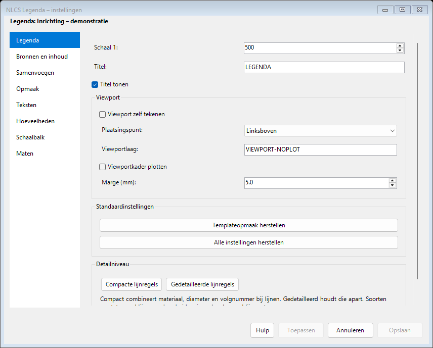
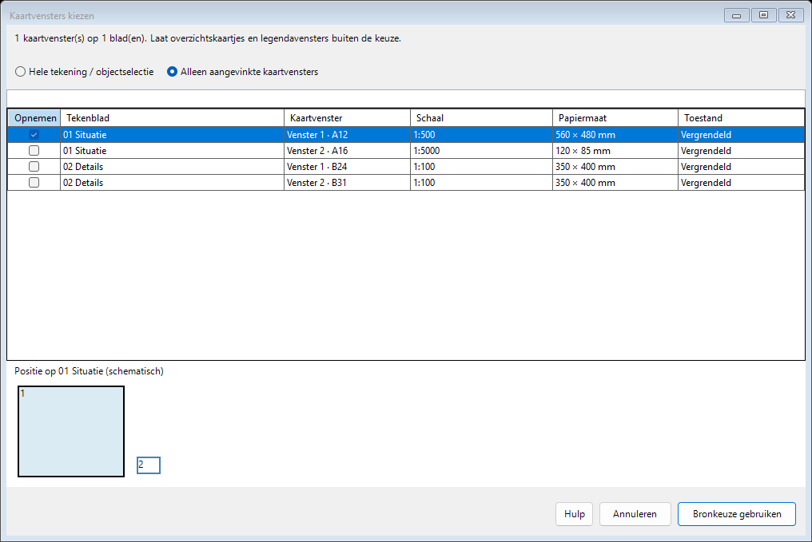
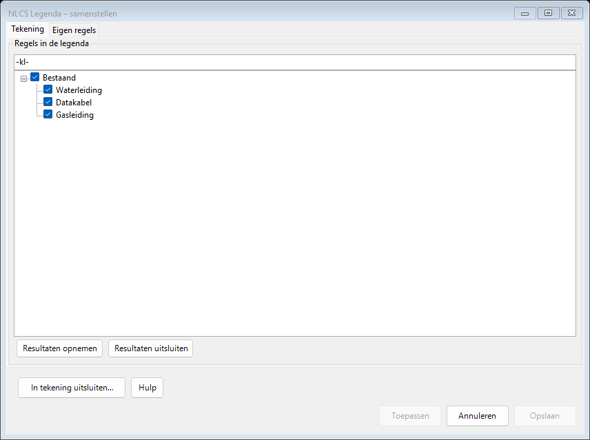
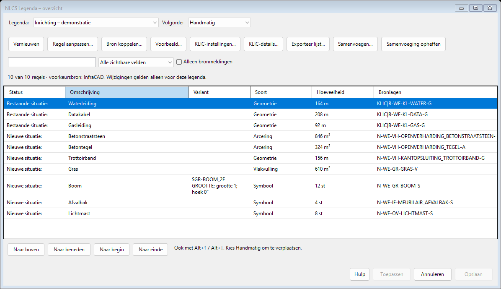
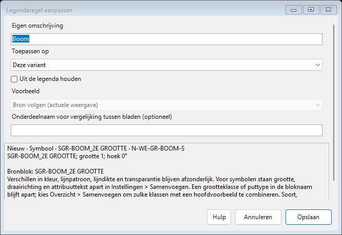
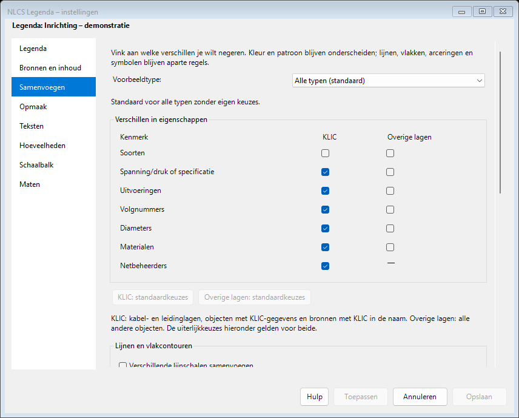
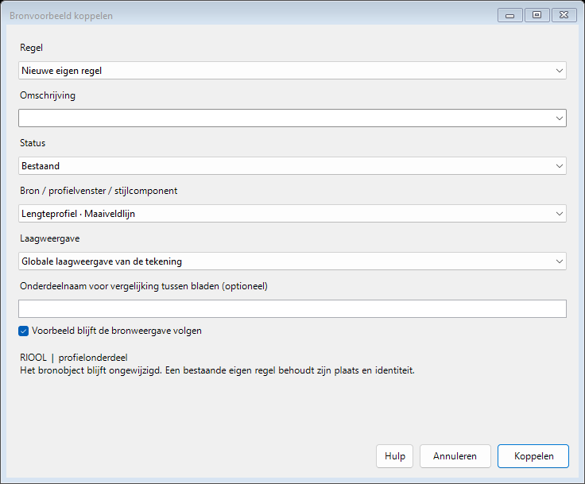
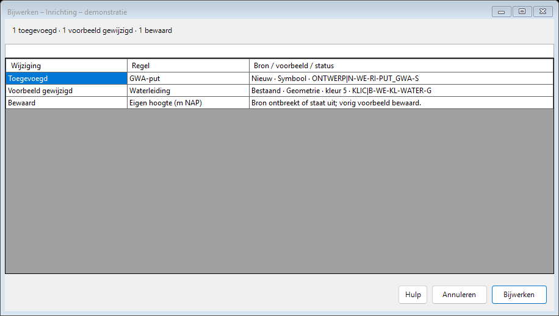
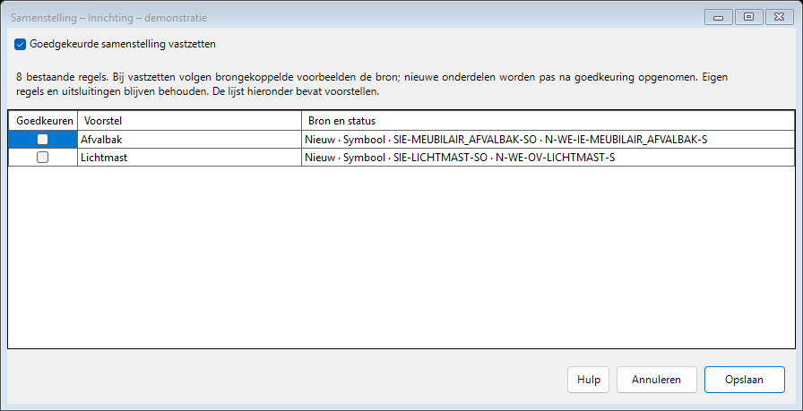

# Handleiding NLCS Legenda

[Installeren](installatie.md) · [Problemen oplossen](problemen-oplossen.md) · [Terug naar het project](../README.md)

Met NLCS Legenda maak je een legenda van de lijnen, arceringen en symbolen in je
tekening. Je kiest welke onderdelen erin komen en hoe ze worden omschreven. Als
het ontwerp verandert, werk je de legenda bij met behoud van je keuzes.

Deze handleiding gaat uit van AutoCAD of Civil 3D en een model dat in meters is
getekend. De knoppen staan op het lint **NLCS Legenda**. De bijbehorende commando's
staan [onderaan](#commandos). Waar **Lokale instellingen → Opmaak** staat, open je
eerst Lokale instellingen en kies je daarna Opmaak in de lijst links.

## Hulp tijdens het werken

Met **Help** op het lint of `NLCSLEGENDAHELP` open je deze handleiding in je browser.
De tekst en afbeeldingen worden met de plug-in geïnstalleerd. Je hebt daarvoor
geen internet nodig. De handleiding hoort bij jouw geïnstalleerde versie en komt
uit dezelfde documentatie als op GitHub.

Druk tijdens een legenda-commando op **F1** voor uitleg over dat commando. In een
instellingenvenster open je met **Hulp** of de F1-toets de uitleg bij het
gekozen onderdeel. Het venster blijft open en je instellingen veranderen niet.
In de handleiding kun je op woorden zoeken, bijvoorbeeld `xrefs` of `schaalbalk`.
Links naar GitHub en andere websites hebben wel internet nodig.

## Waar wil je mee aan de slag?

- [Een eerste legenda plaatsen](#eerste-legenda)
- [Instellingen voor één legenda of voor nieuwe legenda's aanpassen](#instellingen)
- [Xrefs en kaartvensters kiezen](#bronnen-kiezen)
- [Regels toevoegen, uitsluiten en ordenen](#de-inhoud-samenstellen)
- [Teksten en statussen aanpassen](#teksten-en-statussen)
- [Regels samenvoegen](#regels-samenvoegen)
- [Schaal, opmaak en opmerkingen instellen](#schaal-en-opmaak)
- [Een eigen voorbeeld of bronobject gebruiken](#voorbeelden-kiezen-en-koppelen)
- [Bijwerken met behoud van je keuzes](#bijwerken-en-keuzes-bewaren)
- [De legenda op een tekenblad plaatsen](#de-legenda-op-een-tekenblad)
- [Instellingen delen en tekenbladen vergelijken](#meerdere-legendas-en-tekenbladen)
- [Hoeveelheden bekijken en exporteren](#hoeveelheden-en-export)

## Eerste legenda

1. Open de tekening waarin de legenda moet komen en ga naar modelruimte.
   Werk je in een kaderbestand met xrefs, open dan dat kaderbestand.
2. Kies **Genereren** op het lint of typ `NLCSLEGENDA`.
3. Kies **Schaal** en vul de schaalnoemer in. Voor een kaart op 1:500 vul je `500` in.
4. Standaard wordt de hele tekening als bron gebruikt. Kies **Uitkiezen** als je
   zelf een selectie wilt aanwijzen.
5. Kies **Plaatsen** en zet de legenda met de muis naast je tekening.
6. Open **Lokale instellingen** om bronnen, inhoud en opmaak te controleren.
   Met **Toepassen** zie je het resultaat meteen in dezelfde legenda.

Een nieuwe legenda komt standaard als één blok in modelruimte te staan. Met
**Exploderen bij plaatsen** kun je losse objecten kiezen. Gebruik in beide
gevallen de functies van de plug-in om teksten en voorbeelden aan te passen.
Rechtstreekse wijzigingen aan de getekende legenda kunnen bij het bijwerken
verdwijnen.

### Leeg beginnen

Je kunt ook een legenda plaatsen als er nog geen regels zijn gevonden. Dat is
handig als je eerst de xrefs wilt kiezen. Open na het plaatsen **Lokale instellingen →
Bronnen en inhoud**, kies de bronnen en klik op **Toepassen**. Eigen regels voeg je
toe via **Samenstellen**.

Met de optie **Blanco** bij Genereren begin je bewust zonder automatische regels.
De samenstelling staat dan vast. Je kunt zelf regels toevoegen. Gevonden
bronregels verschijnen als voorstel en komen pas in de legenda nadat je ze
goedkeurt via **Samenstelling vastzetten**. Daar kun je het vastzetten ook uitzetten.

Staan titel, opmerkingen, kader en alle andere zichtbare onderdelen uit, dan
verschijnt de hulptekst **Lege legenda**. Die wordt niet geplot en zorgt ervoor
dat je de legenda nog kunt aanwijzen.

### Werken in een kaderbestand met xrefs

Voor een tekenblad met een aparte ondergrond of KLIC-xref werkt deze volgorde prettig:

1. Plaats de legenda in het kaderbestand, eventueel eerst leeg.
2. Kies onder **Lokale instellingen → Bronnen en inhoud → Xrefs…** de benodigde xrefs.
3. Kies **Kaartvensters** als alleen de inhoud van bepaalde kaarten op het blad
   mag meetellen. Laat een overzichtskaartje en het venster van de legenda uitgevinkt.
4. Controleer via **Samenstellen** welke regels je wilt opnemen.
5. Pas omschrijvingen en volgorde aan in **Overzicht**.
6. Gebruik **Samenstelling vastzetten** zodra de inhoud is goedgekeurd.
7. Plaats de legenda op de layout met **Viewport** of **Naar model of layout**.

Een *kaartvenster* toont het ontwerp op je layout. Het kan bepalen welke
bronobjecten in de legenda horen. Een *legendavenster* toont de legenda zelf.
Dat venster is dus geen bron voor de legenda.

## Instellingen

Elke legenda bewaart haar eigen instellingen in de DWG. De globale standaard is
alleen het startpunt voor nieuwe legenda's.

| Wat wil je aanpassen? | Gebruik | Gevolg |
| --- | --- | --- |
| De legenda waaraan je nu werkt | **Lokale instellingen** | Alleen de gekozen legenda verandert. |
| De opzet voor volgende legenda's | **Globale standaard** | Bestaande legenda's houden hun instellingen. |
| Een opzet bewaren of delen | **Profielen** | Je slaat instellingen op en kiest later waar je ze wilt laden. |

Bij één legenda openen de lokale instellingen direct. Bij meerdere legenda's
wijs je de gewenste legenda aan of kies je die uit een lijst. De globale
standaard kun je ook aanpassen als er nog geen legenda is geplaatst.

**Toepassen** werkt de gekozen legenda bij en houdt het venster open. **Opslaan**
doet hetzelfde en sluit het venster. Na Toepassen zijn beide knoppen uitgeschakeld
totdat je weer iets wijzigt. **Annuleren** sluit het venster zonder de nog niet
toegepaste wijzigingen op te slaan. Eerder toegepaste wijzigingen blijven staan.
Lukt het toepassen niet, dan blijft het venster open en blijft de vorige legenda behouden.

## Bronnen kiezen

Een *bron* is de tekening of xref waaruit een legendaregel wordt afgeleid. Het
*voorbeeld* is het stukje lijn, arcering of symbool dat naast de omschrijving staat.
Meerdere bronobjecten kunnen samen één legendaregel vormen.

### Xrefs

Open **Lokale instellingen → Bronnen en inhoud → Xrefs…** om per xref te kiezen
of die meetelt. Het commando `NLCSLEGENDAXREFS` opent dezelfde keuze.

**Xrefs meenemen** schakelt alle xrefs tegelijk in of uit en vervangt eerdere
uitzonderingen. Gebruik daarom **Xrefs…** als je afzonderlijke bronnen wilt kiezen.
Een uitgeschakelde bovenliggende xref sluit ook de daarin geneste xrefs uit.

De plug-in kan voorbeelden uit alleen-lezen of vergrendelde bronnen gebruiken.
Ze worden op lokale legendalagen getekend. De bron-xrefs blijven ongewijzigd.

Is een bronbestand op schijf gewijzigd sinds het laden, herlaad die xref dan
voordat je de legenda bijwerkt. Bij een verschil tussen de geladen en opgeslagen
bronversie geeft de plug-in een melding en blijft de vorige legenda behouden.

### Kaartvensters kiezen

Met **Kaartvensters** of **Bronnen en inhoud → Kaartvensters kiezen…** beperk je
de bron tot de kaarten die bij deze legenda horen.

1. Open **Lijst**. Je ziet de kaartvensters van alle layouts, ook als je zelf in
   modelruimte werkt.
2. Zoek op de bladnaam en vergelijk de schaal, papiermaat en schematische positie.
3. Vink de gewenste kaarten aan. Laat overzichtskaarten en vensters die een
   legenda tonen uitgevinkt. Gekoppelde legendavensters worden al uit de lijst gelaten.
4. Bevestig de bronkeuze.

Het zoekfilter verbergt alleen regels in de lijst. Eerder gezette vinkjes blijven
bewaard. Een venster op een andere layout is gewoon te kiezen. Een uitgezet
venster niet. Ontbreekt een eerder gekozen venster, dan blijft dat in de lijst
zichtbaar totdat je de bronkeuze herstelt.

Met **Toevoegen** kun je vensters op het huidige blad aanwijzen. **HeleTekening**
verwijdert de beperking tot kaartvensters. Deze keuze hoort bij de DWG en wordt
niet overgenomen in de globale standaard.

Alleen het zichtbare kaartgebied telt mee. Een bronobject met dezelfde weergave
wordt bij overlappende kaartvensters één keer geteld. Bij verschillende kaartschalen
krijg je een melding. De ingestelde legendaschaal verandert daardoor niet.
Gebruik een orthogonale kaartweergave. Perspectiefvensters worden niet ondersteund.

### Kleuren en stijlen van de kaart volgen

Zonder gekozen kaartvensters gebruikt de legenda de algemene laaginstellingen
van het kaderbestand, inclusief aangepaste xref- en KLIC-kleuren.

Na het kiezen van kaartvensters staat **Laagweergave uit de gekozen kaartvensters**
standaard aan. Voorbeelden volgen dan de kleur, het lijntype, de lijndikte en de
transparantie van die vensters. Ook zichtbare delen van symbolen tellen mee.

Zet deze optie uit om de algemene laagweergave te gebruiken. De kaartbegrenzing
en bevroren lagen blijven dan wel bepalen wat meetelt. **Broncontrole** maakt
verschillen met de viewportweergave zichtbaar. De plug-in verandert de bronlagen
en kaartvensters hiervoor niet.

### Nagaan waarom iets ontbreekt

Met **Controleren** wijs je één bronobject aan. Je ziet waarom het wel of niet
in de gekozen legenda wordt opgenomen. Denk aan een uitgeschakelde xref, status,
hoofdgroep, objectsoort of een eerder uitgesloten regel.

**Broncontrole** geeft een doorzoekbare lijst. Daarin staan ook verborgen of
niet-plottende objecten, objecten buiten de kaart en onbekende lagen. Gebruik
deze lijst als er meer ontbreekt dan één regel.

## De inhoud samenstellen

### Regels kiezen en zoeken

Open **Samenstellen**. Het tabblad **Tekening** bevat de gevonden bronregels.
Onder **Eigen regels** staan de regels die je zelf hebt toegevoegd. De keuzes
gelden alleen voor de legenda die je bewerkt.

Je kunt zoeken op elk deel van een omschrijving of laagnaam, ook binnen een
xref-naam. Je hoeft voor een gewone zoekopdracht geen sterretjes te typen.

| Zoekopdracht | Resultaat |
| --- | --- |
| `asfalt` | Regels waarin asfalt voorkomt, ook midden in de naam. |
| `fiets asfalt` | Regels waarin beide woorden voorkomen, ongeacht hun volgorde. |
| `*asfalt*fiets*` | Regels waarin asfalt vóór fiets voorkomt. |

**Resultaten opnemen** en **Resultaten uitsluiten** werken op de zichtbare
zoekresultaten. Kleurvarianten staan apart in de lijst en houden hun eigen keuze.

Lijnen, vlakcontouren, arceringen, vlakvullingen en symbolen worden als afzonderlijke
soorten voorbeelden behandeld. Onder **Bronnen en inhoud → Elementsoorten** kun
je ze aan- of uitzetten. Standaard staan ze allemaal aan.

### Objecten aanklikken om regels uit te sluiten

1. Kies **Samenstellen → In tekening uitsluiten** of typ `NLCSLEGENDAUITVINKEN`.
2. Klik de ongewenste objecten achter elkaar aan. Dit werkt ook binnen xrefs.
3. Druk op Enter om de keuzes toe te passen. De legenda wordt daarna één keer bijgewerkt.

Escape annuleert de aanklikronde. De bronobjecten blijven staan. Je sluit hun
legendaregel uit, niet alleen dat ene aangeklikte exemplaar. Via Samenstellen
kun je de regel weer opnemen.

### Overzicht en eigen volgorde

**Overzicht** toont de regels, hoeveelheden, bronlagen en beschikbare KLIC-gegevens
van de gekozen legenda. Lege kolommen worden waar mogelijk verborgen. Zelf
gekozen KLIC-kolommen blijven zichtbaar.

Met **Vernieuwen** lees je de bron opnieuw in de lijst. De getekende legenda
verandert dan nog niet. Met **Toepassen** werk je de legenda wel bij. **Opslaan** past
de wijzigingen toe en sluit het venster.

Voor een eigen volgorde:

1. Maak het zoekfilter leeg.
2. Zet **Volgorde** op **Handmatig**.
3. Selecteer een regel en verplaats die met de knoppen of met Alt+↑ en Alt+↓.
4. Klik op **Toepassen** of **Opslaan**.

Tijdelijk uitgezette regels onthouden hun plaats. Nieuwe regels komen achteraan.
Andere legenda's houden hun eigen volgorde.

### Eigen regels en eigen lagen

Gebruik een **eigen regel** voor een voorbeeld dat je zelf in de legenda wilt
zetten, ook als er geen bijbehorend bronobject is. Een eigen regel heeft geen
gemeten bronhoeveelheid.

Met **Laag toevoegen** in Samenstellen kies je een lokale laag of xref-laag.
De lijst toont de bron, laagnaam en het blok of arceringspatroon apart. Je kunt
op die gegevens zoeken en meerdere voorbeelden op dezelfde laag apart kiezen.
De voorgestelde omschrijving en het type kun je aanpassen.

Wil je echte objecten op een niet-NLCS-laag laten meetellen, gebruik dan **Eigen
lagen** in de instellingen. Kies de laag, het type en de meetwijze: lengte,
aantal of oppervlak. Kies ook de bron. Dat kan alleen de hoofdtekening zijn,
één specifieke xref of elke bron die voor deze legenda is ingeschakeld.

Met **Laag kiezen** worden bron, type en blok overgenomen. Je kunt ook een
volledige naam zoals `ONDERGROND|laag` plakken. De bronkoppeling wordt dan ingevuld.
Een eigen laag verschijnt pas in de legenda als er passende bronobjecten zijn.
Gelijknamige lagen in de hoofdtekening en een xref blijven via hun bron herkenbaar.

### Een getekende regel overnemen

Met **Regel overnemen** maak je een bestaande, handmatig getekende regel onderdeel
van een beheerde legenda. Dit kan ook met een eigen hoogtevoorbeeld of controlesymbool.

1. Kies de legenda waaraan de regel moet worden toegevoegd. Kies **NieuweLegenda**
   als er nog geen beheerde legenda is.
2. Kies de omschrijving.
3. Selecteer alleen de objecten die bij het voorbeeld horen.
4. Kies de status.

De plug-in bewaart een lokale kopie van het voorbeeld. De oude tekst en het
geselecteerde voorbeeld worden pas vervangen als de nieuwe legenda is opgebouwd.
De regel blijft in dezelfde modelruimte of layout en kan daarna via Samenstellen
worden onderhouden. Een bronbestand of xref wordt niet aangepast.

### Blanco regels

Met **Blanco regels** reserveer je lege regels, bijvoorbeeld voor een latere
aanvulling. Elke regel begint met een leeg voorbeeldvak en de tekst `[blanco]`.
Je kunt tekst en status aanpassen. Blanco regels hebben geen bronhoeveelheid en
blijven bij bijwerken en heropenen bewaard.

Losse geometrie die je later met de hand bijtekent, hoort daarmee nog niet bij
de opgeslagen regel. Gebruik **Regel overnemen** als ook dat voorbeeld moet blijven.

## Teksten en statussen

### Een omschrijving aanpassen

Kies **Elementtekst** en wijs de bron of legendaregel aan. Je kunt ook
**Overzicht → Regel aanpassen** gebruiken. De bronlaag en het bronblok hoeven
niet te worden hernoemd. Werk een oudere legenda eerst bij als de tekstkoppeling
nog ontbreekt. Eigen regels kun je ook via Samenstellen bewerken.

Bij Regel aanpassen kies je waar de omschrijving of uitsluiting voor geldt:

| Keuze | Gebruik |
| --- | --- |
| Deze variant | Alleen deze bronobjecten, ook na een kleur- of stijlwijziging. |
| Deze bronlaag en objectsoort | Ook toekomstige objecten van die soort op dezelfde bronlaag. |
| Dit bronsymbool op deze laag | Ook nieuwe exemplaren van hetzelfde bronblok op die laag. |

Een keuze voor één variant gaat vóór een bredere laagkeuze. De keuzes blijven
per status gelden. Een uitgesloten bestaande kabel sluit daardoor niet vanzelf
een nieuwe kabel uit. Een individuele regel weer aanvinken in Samenstellen
maakt een uitzondering op een brede uitsluiting. Andere filters, zoals xref en
status, blijven wel gelden.

De plug-in gebruikt eerst je eigen omschrijving. Daarna zoekt ze naar een gevuld
KLIC-attribuut `OMSCHRIJVING`, een bruikbare laagbeschrijving, een herkende
BGT-bloknaam en een omschrijving in de ingebouwde catalogus. Als die ontbreken,
wordt de laagnaam zo leesbaar mogelijk gemaakt. Technische labels zoals
`NLCS-basis` worden niet als objectomschrijving gebruikt. Zelf ingevulde teksten
blijven behouden.

Via **Omschrijvingen** kun je meerdere teksten in een tabel aanpassen. Deze
teksten horen bij de gekozen legenda. Voor volgende legenda's pas je de
omschrijvingen in **Globale standaard** aan.

### Statussen

De vaste statussen zijn Nieuw, Bestaand, Vervallen, Tijdelijk en Revisie. De
standaardkoppen zijn **Nieuwe situatie:**, **Bestaande situatie:**,
**Vervallen situatie:**, **Tijdelijke situatie:** en **Revisie**.
Je kunt de kopteksten aanpassen in de instellingen.

Via **Statussen** maak je eigen statussen en wijs je daar regels aan toe.
Automatische regels kies je door bronobjecten aan te wijzen. Handmatige regels
kies je uit een lijst. Een toegewezen regel verschijnt onder de eigen status,
ook als de oorspronkelijke status is uitgeschakeld.

Laat **Gelijke statussen samenvoegen** uit als nieuwe en bestaande onderdelen
afzonderlijk moeten blijven. De werking staat bij [Regels samenvoegen](#regels-samenvoegen).

## Regels samenvoegen

### Wat betekent een vinkje?

Onder **Lokale instellingen → Samenvoegen** betekent een aangevinkt kenmerk:
**negeer dit verschil bij het vergelijken van regels**.

Met **Diameters samenvoegen** kunnen bijvoorbeeld een leiding van 200 en een
leiding van 300 één legendaregel worden. Daarvoor moeten de overige eigenschappen
nog wel overeenkomen. Een verschil in kleur wordt niet door dat vinkje genegeerd.

**Soorten samenvoegen** zou ook het verschil tussen bijvoorbeeld gas en water
negeren. Die optie staat daarom standaard uit. Je hoeft deze niet aan te zetten
om leidingen van dezelfde soort bij elkaar te houden.

| Samenvoegkeuze | KLIC, standaard | Overige lagen, standaard |
| --- | --- | --- |
| Soorten | Uit | Uit |
| Spanning/druk, uitvoering en volgnummer | Aan | Uit |
| Diameters en materialen | Aan | Uit |
| Netbeheerders | Aan | Uit |

Deze beginwaarden gelden voor nieuwe instellingen. Bestaande legenda's bewaren
hun lokale keuzes. Oude globale profielen zonder deze keuzes krijgen de
beginwaarden eenmalig mee. Daarna blijven ook bewust uitgezette opties behouden.

KLIC en overige lagen hebben ieder hun eigen instellingen. KLIC-rioollagen onder
hoofdgroep RI worden als KLIC behandeld wanneer ze KLIC-objectgegevens hebben of
uit een bron met KLIC in de naam komen. Discipline en hoofdgroep blijven grenzen
voor het automatisch samenvoegen.

### Keuzes per voorbeeldtype

Kies bij **Voorbeeldtype** eerst **Alle typen (standaard)** of een afzonderlijk
type, zoals Lijnen. Zo kun je diameters bij lijnen samenvoegen en bij symbolen
apart houden. Een type zonder eigen keuzes volgt de standaard.

**KLIC: standaardkeuzes** en **Overige lagen: standaardkeuzes** heffen de afwijking
voor het gekozen type op. De twee groepen blijven onafhankelijk van elkaar.

Onder de eigenschappen staan keuzes voor het uiterlijk. Die gelden voor KLIC
én overige lagen en staan standaard uit:

| Keuze | Welk verschil wordt genegeerd? | Wat blijft onderscheiden? |
| --- | --- | --- |
| Lijnschalen | De herhalingsafstand van hetzelfde lijnpatroon. | Kleur, lijndikte en lijnbreedte. |
| Arceerschalen en arceerhoeken | Schaal en hoek van hetzelfde patroon. Bij een gebruikersarcering gaat het om de lijnafstand. | Patroon, kleur, achtergrondkleur en transparantie. |
| Verschillende groottes samenvoegen | Een gelijkmatig vergrote of verkleinde versie van dezelfde symboolvorm. | Andere vormen, spiegeling en vervorming. |
| Verschillende draairichtingen samenvoegen | De rotatie van het symbool in het tekeningvlak. | Andere vormen en spiegeling. |
| Verschillende attribuutteksten samenvoegen | Wisselende teksten in blokattributen, zoals nummers. | De symboolvorm en overige weergaveverschillen. |

Kleurverschillen blijven bij automatisch samenvoegen apart. Ook lijnen,
vlakcontouren, arceringen, vlakvullingen en symbolen houden elk hun eigen regels.
Voor het verkleinen van een symbool in het voorbeeldvak gebruik je een andere
optie: **Opmaak → Symbolen → Passend maken in het voorbeeldvak**.

### Diameters, materialen en netbeheerders

**Diameters samenvoegen** werkt met diameters in laagnamen en in KLIC-objectgegevens.
Voorbeelden zijn `VRIJVERVAL_200`, `DN200`, `DN_200` en `Ø200`. Maten met mm, cm of m
worden ook herkend. Een los getal telt alleen bij bekende leidingsoorten als
diameter. Een aanduiding zoals `DATA2` is geen diameter.

**Materialen samenvoegen** herkent onder meer PVC, PE, beton en staal in de
laagnaam en leest materiaal uit KLIC-objectgegevens. Onbekende materiaalnamen
worden niet geraden. Er is voor diameter of materiaal geen tweede instelling
nodig in het KLIC-venster. Een oudere keuze voor afzonderlijke materialen wordt
overgenomen bij Samenvoegen.

Een netbeheerder wordt uit KLIC-gegevens gelezen. Daarmee kan ook een beheerder
achter in een laagnaam worden herkend, ondanks andere punten of spaties.
Zonder die gegevens wordt geen beheerder uit een volgnummer of laagnaam afgeleid.

### De samengevoegde waarden in de tekst

**Samengevoegde waarden tonen** staat standaard aan. Daardoor kan de lezer nog
zien welke varianten achter één regel zitten:

| Afzonderlijke regels | Waarden tonen aan | Waarden tonen uit |
| --- | --- | --- |
| Leiding 200 en Leiding 300 | Leiding (200, 300) | Leiding |
| Leiding Dorp en Leiding Stad | Leiding (Dorp, Stad) | Leiding |

Ook materiaal-, lijnschaal- en arceerverschillen kunnen in de tekst worden vermeld,
bijvoorbeeld **Leiding (lijnschaal 1 / 2)**. De bronobjecten, hoeveelheden en
detailgegevens blijven bewaard, ook als je de waarden niet in de omschrijving toont.

### Zelf regels samenvoegen

Gebruik handmatig samenvoegen als jij bepaalt dat verschillende voorbeelden
één regel mogen worden. Dat kan bijvoorbeeld bij twee boomsymbolen die niet
precies dezelfde vorm hebben.

1. Selecteer in **Overzicht** meerdere regels met Ctrl of Shift.
2. Kies **Samenvoegen…**.
3. Kies het **hoofdobject**. De groep gebruikt daarvan de kleur, lijn en het symbool.
4. Controleer de omschrijving en pas de wijziging toe.

De voorgestelde titel gebruikt het gemeenschappelijke deel van de omschrijvingen.
Ontbreekt dat, dan blijft de titel van het hoofdobject staan. Handmatig samenvoegen
kan ook verschillende kleuren combineren. Hoeveelheden met dezelfde eenheid
worden opgeteld. Blanco regels en regels met verschillende eenheden kun je niet
op deze manier samenvoegen.

**Samenvoeging opheffen** brengt de losse regels terug. Hef een bestaande groep
eerst op voordat je een andere groep maakt. Als het hoofdobject uit de bron
verdwijnt, worden de overgebleven regels weer afzonderlijk weergegeven.
Eigen en blanco regels vallen buiten automatisch samenvoegen.

### Bomen, putten en statussen

De kolom **Variant** helpt verklaren waarom symbolen zijn gesplitst. Je ziet er
onder meer bronblok, grootte, draairichting en weergave. Een expliciete boomklasse
zoals `SGR-BOOM_2E GROOTTE` krijgt de tekst **Boom 2e grootte**. Een volgnummer
zoals `_01` wordt niet als grootteklasse uitgelegd.

**Putten zonder afzonderlijke putnummers** staat standaard aan onder **Bijwerken**
in de instellingen. Bekende nummerattributen zoals `PUTNUMMER`, `PUTNR` en `PUT_ID`
maken dan geen aparte regels en worden niet in het voorbeeld getekend. Puttypen
en statussen blijven behouden. Een putnummer dat als gewone geometrie in een
blok staat, wordt niet verwijderd. Gebruik daarvoor een eigen voorbeeld zonder nummer.

**Gelijke statussen samenvoegen** staat standaard uit. Zet je dit aan, dan kunnen
gelijke regels uit verschillende statussen worden gecombineerd. Hun voorbeelden
moeten er volledig hetzelfde uitzien. Bij al samengevoegde regels geldt dat voor
alle oorspronkelijke weergaven. Laat de optie uit als bijvoorbeeld nieuwe en
bestaande kabels altijd hun eigen regel moeten houden.

## Schaal en opmaak

### Papiermaten en modelruimte

Nieuwe legenda's beginnen met de maatvoering van de TAUW-template. De legenda
rekent papiermaten om naar modelruimte in meters. Bij 1:500 wordt een tekst van
2,5 mm op papier bijvoorbeeld 1,25 m hoog in modelruimte. Dat is dus niet de
hoogte die je op het geplotte blad ziet.

Stel de schaal in onder **Lokale instellingen → Legenda**. Gebruik voor een
legenda in modelruimte dezelfde schaal als het legendavenster op de layout.
Een met de plug-in gekoppeld legendavenster volgt een schaalwijziging automatisch.

Standaard zijn omschrijvingen en statuskoppen 2,5 mm hoog op papier. De titel is
5 mm hoog. De tekststijl is `NLCS-ISO`, met lettertype `NLCS-ISO.ttf`. Ontbreekt
dat lettertype, installeer het via je organisatie of kies een beschikbare
tekststijl. Alle legendatekst wordt als MText getekend. Pas de tekst via de
plug-in aan als de wijziging na Bijwerken behouden moet blijven.

Met **Lokale instellingen → Legenda → Templateopmaak herstellen** zet je de
templateopmaak terug. Daarbij worden ook extra hoeveelheden en de totaalregel
uitgezet. Eigen teksten, schaal, handmatige volgorde en bronkeuzes blijven
behouden. Dit is iets anders dan **Resetten**, dat ook je samenstelling en
overige lokale instellingen vervangt.

Eigen maten blijven normaal bewaard. Alleen herkenbare oude globale
standaardmaten worden bij het lezen omgezet naar de TAUW-maatvoering.
De exacte maten en uitzonderingen staan in [Maatvoering](template-maatvoering.md).

### Symbolen en voorbeeldvakken

Symbolen behouden standaard hun maat uit het model. Een expliciete NLCS-schaalvariant
wordt omgerekend naar de gekozen legendaschaal. Grote symbolen krijgen meer
ruimte in hun rij en kolom.

Zet **Opmaak → Symbolen → Passend maken in het voorbeeldvak** aan als je symbolen
evenredig wilt verkleinen of vergroten tot het ingestelde vak. Een bewust gekozen
templatevoorbeeld houdt zijn eigen opmaak.

Gelijke vormen met verschillende groottes kunnen worden samengevoegd. Dat werkt
ook bij afzonderlijke blokdefinities met dezelfde vorm. Een symbool waarvan alleen
de buitencontour groter is, terwijl de rest niet meeschaalt, is een andere vorm.
Gebruik daarvoor zo nodig handmatig samenvoegen met een gekozen hoofdobject.

De hulpkaders rond voorbeelden zijn in modelruimte zichtbaar en worden niet
geplot. Een buitenkader staat standaard uit. Met **Lichte voorbeelden omranden
bij plotten** geef je bijna witte voorbeelden een dunne plotbare rand op een
eigen legendalaag.

### Kolommen en beschikbare ruimte

De maximale hoogte onder **Kolommen** geldt voor de hele legenda. Lange teksten,
symbolen, koppen, opmerkingen, schaalbalk en een eventueel kader tellen allemaal
mee. Ook het maximumaantal regels per kolom blijft gelden. Past één regel niet,
vergroot dan de hoogte of zet die op `0` om deze hoogtebeperking uit te schakelen.

**Kolommen balanceren** verdeelt de inhoud op basis van de werkelijke hoogte.
Met **Statusgroep bijeenhouden als die in één kolom past** begint zo'n groep
zo nodig in de volgende kolom. Een grotere groep loopt door met een herhaalde
kop. Een kop blijft altijd bij een regel staan.

**Binnen het bestaande legendavenster blijven** staat standaard aan. Bij een
gekoppeld venster zoekt de plug-in een indeling binnen de bestaande ruimte.
Plaats, venstergrootte, plotschaal en teksthoogte blijven behouden. Past de inhoud
niet leesbaar, dan wordt de update niet doorgevoerd en krijg je een melding.
Pas dan de beschikbare ruimte of inhoud aan. Zonder gekoppeld legendavenster
geldt de ingestelde opmaak.

### Opmerkingen en schaalbalk

Onder de legenda staan standaard tekeningnotities, een schaalbalk en de schaaltekst.
Je kunt deze onderdelen aanpassen of uitzetten.

In **Opmerkingen** kies je tekeningnotities, de KLIC-waarschuwing, beide samen of
eigen tekst. Klik op **Tekst overnemen** en pas de tekst daarna aan je tekening
aan. De algemene teksten komen uit de TAUW-template. Projectspecifieke
beplantingslijsten zijn geen algemene standaardtekst.

De kop Opmerkingen volgt de laag **X-XX-AL-LEGENDA-T50**, standaard kleur ACI 130
zoals in de template. Een eigen laagkleur via de Layer Manager blijft bij
bijwerken behouden.

De standaard schaalbalk is 40 mm breed op papier. Hij bestaat uit vier segmenten
van 10 mm met afwisselende halve vullingen. De maten en teksten stel je in onder
**Schaalbalk**.

## Voorbeelden kiezen en koppelen

### Een bronobject als voorbeeld gebruiken

Met **Gekoppeld voorbeeld** wijs je een bronobject aan, ook binnen een xref.
Je maakt daarmee een nieuwe eigen regel of koppelt een bestaande eigen regel.
Geef de gewenste omschrijving en kies hoe het voorbeeld moet worden bijgewerkt.

| Keuze | Wat gebeurt er bij Bijwerken? |
| --- | --- |
| **Bron volgen** | Het voorbeeld wordt opnieuw uit de bron opgebouwd, met de actuele kleur, het lijntype, de lijndikte en transparantie. |
| **Voorbeeld vastzetten** | De huidige weergave blijft staan. Overzicht meldt verschillen met de gekoppelde bron, maar past het voorbeeld niet aan. |

Met **Laagweergave** kies je welke laaginstellingen het voorbeeld gebruikt.
Standaard is dat de algemene laagweergave van het kaderbestand. Je kunt een
kaartvenster kiezen om zijn laagafwijkingen te gebruiken. Die keuze geldt voor
het voorbeeld en verandert niet het brongebied van de hele legenda.

Je kunt deze keuzes later wijzigen via **Overzicht → Regel aanpassen**.
Een eigen regel zonder bronkoppeling blijft een eigen voorbeeld. De plug-in
kiest niet zelf een bron op basis van alleen de omschrijving. Koppel die regel
eenmalig als je wilt dat het voorbeeld de bron volgt. Een legenda met alleen
eigen regels zonder bronkoppeling hoort geen melding over ontbrekende bronobjecten te geven.

### Voorbeelden uit Civil 3D-profielen

Bij een profielonderdeel kies je het profielvenster en de zichtbare stijlcomponent,
zoals een maaiveldlijn, rioolhartlijn, wand, put of putarcering. Een afwijkende
stijl in het profielvenster gaat vóór de basisstijl.

Lijnen en wanden worden schematisch getekend met hun werkelijke stijl. Putvormen
komen uit het profielonderdeel. Neem een eigen markering, zoals een rode overlap
bij een rioolkruising, als afzonderlijk bronobject op. De koppeling bewaart de
gekozen component. Een riooltype wordt niet uit alleen de kleur afgeleid.

### Voorbeelden uit een bibliotheek

Kies in **Overzicht** een regel en open **Voorbeeld…**. Via **Bibliotheek…** kies
je de bijbehorende voorbeeldenbibliotheek in DWG-formaat.

- **Uit tekening** gebruikt de brongeometrie.
- **Automatisch** kiest een passend voorbeeld als er één duidelijke keuze is
  en de bronkleuren behouden blijven. Bij bemonsterde symbolen blijft de
  werkelijke bronvorm leidend.
- Een zelf gekozen bibliotheekvoorbeeld gebruikt zijn eigen weergave.
- **Als nieuwe regel** voegt het voorbeeld toe als eigen regel zonder bronhoeveelheid.

Samengestelde voorbeelden bewaren hun lijnen, arceringen, symbolen en codes
met de onderlinge afstanden en schaal. Gebruikte voorbeelden worden in de DWG
bewaard en zijn na heropenen ook zonder de bibliotheek beschikbaar. Voor een
nieuw voorbeeld heb je het bibliotheekbestand wel nodig.

Als de bibliotheek is gewijzigd, gebruikt Toepassen of Bijwerken de nieuwe
versie van het gekozen voorbeeld. Andere legenda's veranderen pas wanneer je
die zelf bijwerkt. Blokken en stijlen van het voorbeeld blijven gescheiden
van gelijknamige onderdelen in de tekening.

Bedrijfseigen bibliotheken zitten niet in de openbare installer. Neem je
bibliotheek mee naar een andere computer en kies daar het nieuwe pad. Een
gewone DWG zonder voorbeeldencatalogus kan niet als bibliotheek worden gebruikt.

## Bijwerken en keuzes bewaren

### Een gewijzigde tekening verwerken

Kies **Bijwerken** om de legenda opnieuw op dezelfde plaats te tekenen. Je
instellingen, uitsluitingen, eigen teksten en handmatige volgorde blijven
voor bestaande bronobjecten bewaard, ook na een kleur- of stijlwijziging.
Een selectielegenda blijft dezelfde bronselectie gebruiken.

Vooraf zie je welke regels worden toegevoegd, verdwijnen, splitsen of
samengaan. Ook gewijzigde voorbeelden en bronmeldingen staan in dit overzicht.
Controleer de wijzigingen voordat je doorgaat. Annuleren laat de vorige legenda
staan. Bij Alles bijwerken verschijnt deze controle ook.

Zonder vaste samenstelling worden nieuwe bronregels volgens je opgeslagen
filters toegevoegd. Met een vaste samenstelling blijven ze eerst voorstellen.
Een volledig uitgevinkte legenda blijft beschikbaar om later weer aan te vullen.

### Goedgekeurde samenstelling vastzetten

Gebruik **Samenstelling vastzetten** als de lijst op het blad is goedgekeurd
en nieuwe bronobjecten niet ongemerkt extra regels mogen opleveren.

Bijwerken houdt de bestaande regels en hun bronvolgende voorbeelden actueel.
Nieuwe automatische regels verschijnen als voorstel. Keur alleen de gewenste
regels goed in het venster Samenstelling vastzetten. Eigen regels die je zelf
toevoegt zijn al een bewuste keuze.

Een vaste samenstelling is niet hetzelfde als een vastgezet voorbeeld. De
samenstelling bepaalt **welke regels** erin staan. De voorbeeldkeuze bepaalt
**of hun uiterlijk de bron volgt**.

Bewuste uitsluitingen en verborgen of niet-plottende bronlagen houden voorrang.
Zet het vastzetten uit om de samenstelling weer automatisch te laten bepalen.
Gebruik op alle werkplekken versie 1.40 of hoger om deze keuzes te bewerken.
Bij opslaan wordt oudere legenda-opslag omgezet. Oudere plug-ins kunnen die
nieuwe opslag niet bewerken.

### Ontbrekende bronnen of onduidelijke koppelingen

Als een bron ontbreekt of is ontladen, kan de vorige regel bewaard blijven met
de toevoeging **(bron ontbreekt of uitgeschakeld)**. Er wordt dan geen actuele
hoeveelheid ingevuld. **Vorige regels bewaren** staat standaard aan. Zet dit
uit als je deze regels niet wilt behouden. Bewuste uitsluitingen en verborgen
of niet-plottende bronlagen blijven voorgaan.

Kan de plug-in een oude regel niet aan één huidige bron koppelen, dan blijft
het vorige voorbeeld staan. Open **Overzicht → Bron koppelen**. De lijst toont
mogelijke bronnen met objectsoort, symbool, status en weergave. Bekijk de
voorbeelden in CAD en kies welke bron bij de regel hoort. Je kunt daarbij
kiezen of het oude voorbeeld moet blijven staan.

Na koppelen verdwijnt de losse bewaarde regel. De bronkeuze wordt in de DWG
opgeslagen. Keur bij een splitsing pas daarna eventuele extra regels goed.

### Opnieuw beginnen met Resetten

**Resetten** vervangt na bevestiging de lokale instellingen en samenstelling
door de huidige globale standaard. Ook een vastgezette samenstelling wordt
gewist. Naam, bronselectie en plaats blijven behouden. Andere legenda's
veranderen niet.

Gebruik Resetten dus alleen als je die eigen keuzes wilt laten vervallen.
Voor een gewijzigd ontwerp gebruik je **Bijwerken**. Voor alleen de
templateopmaak gebruik je **Templateopmaak herstellen**.

## De legenda op een tekenblad

### Een viewport rond de legenda

Laat de legenda in modelruimte staan en ga naar de gewenste layout. Kies
**Viewport** om een gekoppeld legendavenster te maken op de ingestelde schaal.
Je kunt het venster plaatsen, zelf een kader tekenen of met **Bestaand** een
bestaand legendavenster koppelen.

Standaard wijs je de **linkerbovenhoek** aan. Onder **Lokale instellingen →
Legenda → Viewport** kun je het **middelpunt** kiezen. Dat gekozen punt blijft
op zijn plaats als een automatisch kader groter wordt.

Het gekoppelde legendavenster blijft vergrendeld en volgt een schaalwijziging
van de legenda. Een handmatig getekend kader houdt zijn papierafmetingen.
De marge kan worden verkleind om de inhoud te laten passen. Een te klein
kader geeft een melding zonder de schaal te veranderen. Bij bijwerken geldt
ook de keuze **Binnen het bestaande legendavenster blijven**.

Zowel getekende als automatisch geplaatste kaders komen standaard op
**VIEWPORT-NOPLOT**, met plotten uit. Laagnaam en plotinstelling zijn aanpasbaar.
Bedenk dat de plotinstelling geldt voor alle objecten op die laag.
Andere viewports worden niet aangepast.

### Verplaatsen tussen modelruimte en papierruimte

Met **Naar model of layout** verplaats je de beheerde legenda zelf:

1. Ga naar de modelruimte of layout waar de legenda moet komen.
2. Werk je nog binnen een kaartvenster, ga dan met `PSPACE` naar papierruimte.
3. Kies **Naar model of layout**, kies de legenda en wijs het nieuwe linkerbovenpunt aan.

Papiermaten, inhoud, volgorde en instellingen blijven behouden. Gaat de legenda
rechtstreeks naar papierruimte, dan wordt het gekoppelde legendavenster
verwijderd. De kaartvensters blijven staan. De legenda kan daarna normaal
worden bijgewerkt.

In papierruimte staat bij de legenda **Voorbeelden schematisch**. De schaal
voor kaart en schaalbalk blijft afzonderlijk bewaard.

## Meerdere legenda's en tekenbladen

### Legenda's beheren

Via **Legenda's** op het lint open je het beheer. Je kunt legenda's bijwerken,
hernoemen, opzoeken, verwijderen en dupliceren. Elke legenda heeft haar eigen
bronselectie en instellingen.

In het beheer kun je ook de bronselectie wijzigen, instellingen van een andere
legenda overnemen of de opzet als globale standaard bewaren. Een lokale
instellingswijziging bouwt die legenda opnieuw op. Gewiste legenda's tellen
niet mee bij het kiezen. Na Undo zijn ze weer beschikbaar.

**Opschonen** verwijdert alleen lege registraties zonder regels, eigen inhoud,
groepsgeometrie of gekoppeld venster. Een legenda met bewaarde regels wegens
een ontbrekende bron wordt niet als leeg verwijderd.

### Bladen vergelijken

**Bladen vergelijken** leest legenda's in andere gekozen DWG's zonder die
bestanden te wijzigen. De vergelijking gebruikt bronlaag, objectsoort,
symboolsoort en status. Verschillende statussen blijven afzonderlijk.

Voor eigen regels of verschillend benoemde bronnen vul je een gedeelde
**Onderdeelnaam voor vergelijking tussen bladen** in. Dat kan via Regel
aanpassen of Gekoppeld voorbeeld. Gebruik op de betrokken bladen dezelfde naam.

De lijst toont afwijkende omschrijvingen en weergaven. Vink een bewuste
uitzondering aan en sla die op. De keuze blijft in de huidige DWG bewaard.
Verandert de betrokken tekst of weergave later, dan wordt de afwijking opnieuw
gemeld. Regels zonder bruikbare bronkoppeling of gedeelde onderdeelnaam worden
als niet vergeleken aangegeven.

### Profielen bewaren en delen

Met **Profielen** bewaar je een opzet voor later. Bij Opslaan en Laden kies je
**Legenda** voor de gekozen legenda of **Standaard** voor nieuwe legenda's.
Standaard werkt ook zonder geplaatste legenda.

Exporteer een profiel naar een JSON-bestand om instellingen met een collega
te delen. Een profiel bevat geen CAD-geometrie of koppelingen naar afzonderlijke
bronobjecten. Bewaar de DWG als je eigen voorbeelden en bronkoppelingen wilt
hergebruiken. Gebruikte bibliotheekvoorbeelden blijven in die DWG aanwezig.

### Projectomschrijvingen delen

Onder **Teksten** kies je een bestand met **Projectbestand kiezen…** of maak
je er een met **Projectbestand opslaan…**. Selecteer hetzelfde bestand bij
andere legenda's om projectomschrijvingen te delen. Bronlagen en bloknamen
blijven gelijk.

Een eigen omschrijving per variant of in de lokale omschrijvingen gaat vóór
het projectbestand. Kies het bestand alleen in de globale standaard als het
ook voor nieuwe legenda's moet gelden.

Het projectbestand moet bereikbaar blijven. Bij een ontbrekend of ongeldig
bestand wordt de oorzaak gemeld en blijft de vorige legenda staan. Neem het
bestand mee naar een andere computer en kies daar het nieuwe pad.
Het [voorbeeldbestand](../deploy/projectomschrijvingen.sample.json) bevat
omschrijvingen en optionele alternatieve namen voor beheerders.

**Leesbare beheerdernamen** verkort bekende namen in de zichtbare tekst.
De volledige bronnaam blijft in de gegevens beschikbaar. Met **Beheerdernamen
in de legenda tonen** zet je de toevoeging aan of uit, ook bij gekozen KLIC-tekstvelden.

## KLIC-gegevens bekijken

De plug-in leest beschikbare KLIC-gegevens uit de hoofdtekening en uit xrefs,
ook als die genest zijn. InfraCAD Map kan deze gegevens opslaan in ingebedde
tabellen, Property Sets of Object Data. Voor Object Data is Civil 3D/Map nodig.
In gewone AutoCAD kunnen aanvullende gegevens ontbreken.

Open **Overzicht → KLIC-details** of dubbelklik op een regel om de gelezen
waarden te bekijken. Je ziet per bron en tabel de gegevens, objectnummers
(handles), voorzorgsmaatregelen en eventuele bijlagen.

Bij **KLIC-instellingen** maak je drie verschillende keuzes:

| Onderdeel | Wat stel je in? |
| --- | --- |
| Overzicht en export | Welke velden als kolommen en in de lijstexport verschijnen. |
| Legenda-omschrijving | Welke eigenschappen achter de omschrijving in de legenda komen. |
| Afzonderlijke regels | Welke extra eigenschappen een eigen legendaregel opleveren. |

Het zoekfilter in Overzicht verandert alleen de lijst en de lijstexport.
Diameter en materiaal stel je centraal in onder **Samenvoegen**. Daarvoor hoef
je geen extra veld onder Afzonderlijke regels te kiezen.

Met **Gegevensbron** bepaal je welke opslagvorm voorrang krijgt. Ontbreekt een
veld daar, dan wordt een andere beschikbare bron gelezen. Een bestaande maar
lege waarde wordt niet vervangen door een waarde uit een andere bron.
Verschillende gevonden waarden blijven zichtbaar.

Een nulwaarde is geen gemeten diepte. Een standaarddiepte wordt apart benoemd.
De plug-in stelt niet vast waar kabels en leidingen werkelijk in het terrein
liggen. De eerste analyse van Object Data in xrefs kan langer duren doordat
de veldindeling uit een tijdelijke bronkopie wordt gelezen. De bron-DWG hoeft
je daarvoor niet zelf te openen.

De tekst `TYPE \ LABEL \ OMSCHRIJVING` bij lege KLIC-attributen wordt standaard
weggelaten. Werkelijke objectgegevens blijven beschikbaar. Meer uitleg over
bronkeuze en gegevens staat bij [KLIC-gegevens](klic-bronnen.md).

## Hoeveelheden en export

**Overzicht** toont aantallen, lengtes en oppervlakken van de gekozen regels.
Bij **Hoeveelheden** stel je in wat op de legenda komt.

Staat er `? m²`, dan kan AutoCAD van een bronarcering geen betrouwbaar oppervlak
bepalen. Ook een totaal met een onbekend deel wordt als onbekend getoond.
Onder **Overzicht → Broncontrole** vind je de laag en het object. Herstel de
broncontour en werk de legenda bij.

| Functie | Uitvoer |
| --- | --- |
| **Exporteren** | De gekozen legenda als CSV en JSON naast de DWG. Zonder legenda wordt de hele tekening met de globale standaard gebruikt. |
| **Exporteer lijst** in Overzicht | Alleen de zichtbare regels naar een bestand dat je zelf kiest. |
| **Batch** | Eén uittrekstaat van de DWG's direct in een gekozen map, met de globale standaard en een kolom Tekening. |

Batch leest de tekeningen zonder ze in een tekenvenster te openen of te wijzigen.
Een onleesbare tekening wordt overgeslagen en gemeld.

CSV gebruikt puntkomma's als kolomscheiding en UTF-8 als tekstcodering.
De numerieke meetkolommen gebruiken een
decimale punt. De kolom Hoeveelheid gebruikt Nederlandse getalnotatie. Kies bij
het importeren in een spreadsheet de passende notatie.

De oorspronkelijke kolom Omschrijving blijft behouden. Legenda-omschrijving
bevat de tekst zoals die wordt getoond, inclusief gekozen KLIC-eigenschappen
en netbeheerders. Bronlagen noemt de oorspronkelijke lagen met xref-voorvoegsels.
Deze twee kolommen staan achter de eventuele KLIC-kolommen.

JSON bevat dezelfde gegevens en een lijst `bronlagen`. Een onbekend oppervlak
blijft leeg in de numerieke CSV-kolom en is `null` in JSON. De bronmelding legt
uit waarom. Eigen regels hebben geen gemeten bronhoeveelheid.

## Plug-in bijwerken

**Bijwerken** vernieuwt een legenda. **Updates controleren** controleert de
versie van de plug-in zelf.

Open **Updates controleren** om de geïnstalleerde versie, de nieuwste stabiele
release en de wijzigingen te zien. Je kiest zelf of je downloadt, uitstelt of
een versie overslaat. Hier kun je ook **Bij opstarten controleren** uitzetten.
Die voorkeur geldt voor jouw Windows-gebruiker en staat los van de legenda-instellingen.

Na downloaden vraagt een apart venster om je werk op te slaan en alle CAD-sessies
te sluiten. Pas daarna kan de installatie doorgaan. Start Civil 3D vervolgens
opnieuw. Zie [Installeren en bijwerken](installatie.md#vanuit-de-plug-in) voor de stappen.

## Commando's

De meeste functies zijn ook bereikbaar via het lint **NLCS Legenda**.

| Commando | Functie |
| --- | --- |
| `NLCSLEGENDA` | Een legenda maken van de tekening, een selectie of een blanco opzet. |
| `NLCSLEGENDAUPDATE` | De gekozen legenda bijwerken met behoud van keuzes. |
| `NLCSLEGENDARESET` | Na bevestiging opnieuw beginnen met de globale standaard. |
| `NLCSLEGENDABEHEER` | Legenda's beheren, dupliceren en hun bron of instellingen wijzigen. |
| `NLCSLEGENDAINFO` | Overzicht openen, hoeveelheden bekijken en regels ordenen. |
| `NLCSLEGENDASAMENSTELLEN` | Regels kiezen en eigen regels toevoegen. |
| `NLCSLEGENDAUITVINKEN` | Bronobjecten aanklikken om hun legendaregel uit te sluiten. |
| `NLCSLEGENDATOEVOEGEN` | Een eigen regel toevoegen met een gekozen type, laag en omschrijving. |
| `NLCSLEGENDAOVERNEMEN` | Een getekende tekst en voorbeeld als blijvende regel overnemen. |
| `NLCSLEGENDAVASTZETTEN` | De samenstelling vastzetten en nieuwe voorstellen beoordelen. |
| `NLCSLEGENDAVOORBEELDKOPPELEN` | Een bronobject of Civil 3D-profielonderdeel koppelen. |
| `NLCSLEGENDAELEMENT` | Voor één object bekijken waarom het wel of niet meetelt. |
| `NLCSLEGENDABRONCONTROLE` | Bronmeldingen en redenen voor ontbrekende regels bekijken. |
| `NLCSLEGENDABRONVENSTER` | Kaartvensters als brongebied kiezen. |
| `NLCSLEGENDAXREFS` | Per xref kiezen of die meetelt. |
| `NLCSLEGENDAOPTIES` | Lokale instellingen van een bestaande legenda aanpassen. |
| `NLCSLEGENDASTANDAARD` | De standaard voor nieuwe legenda's aanpassen. |
| `NLCSLEGENDAOMSCHRIJVINGEN` | Omschrijvingen in een tabel bewerken. |
| `NLCSLEGENDATEKST` | De tekst van een aangeklikt element aanpassen. |
| `NLCSLEGENDASTATUS` | Eigen statussen maken en regels toewijzen. |
| `NLCSLEGENDALAAGNAAM` | Een NLCS-laagnaam per onderdeel bewerken en de laag hernoemen. |
| `NLCSLEGENDAVIEWPORT` | Een legendavenster op de layout maken of koppelen. |
| `NLCSLEGENDAVERPLAATSEN` | Een legenda tussen modelruimte en papierruimte verplaatsen. |
| `NLCSLEGENDAVERGELIJKEN` | Teksten en voorbeelden tussen tekenbladen vergelijken. |
| `NLCSLEGENDAPRESET` | Instellingen als profiel bewaren, laden, exporteren of importeren. |
| `NLCSLEGENDAEXPORT` | Een legenda naar CSV en JSON exporteren. |
| `NLCSLEGENDABATCH` | Een uittrekstaat maken van DWG's in een map. |
| `NLCSLEGENDACONFIG` | De globale instellingenbestanden aanmaken en hun paden tonen. |
| `NLCSLEGENDAUPDATES` | Op een nieuwe plug-inversie controleren. |
| `NLCSLEGENDAHELP` | De ingebouwde uitleg en geladen versie bekijken. |

## Aanvullende informatie

### Instellingenbestanden

De globale bestanden staan in `%APPDATA%\NlcsLegenda\settings.json` en
`omschrijvingen.json`. **Bestanden** toont de paden. Voor normaal gebruik pas je
de instellingen via de vensters aan. Voorbeelden staan bij
[instellingen](../deploy/settings.sample.json) en
[omschrijvingen](../deploy/omschrijvingen.sample.json).

Onder **Legenda → Detailniveau** zetten **Compacte lijnregels** en
**Gedetailleerde lijnregels** de keuzes voor diameter, materiaal, nummer en het
tonen van samengevoegde waarden tegelijk. Leidingsoorten en statussen blijven
apart. Symboolkeuzes veranderen niet. Bij Info en Overig kan de plug-in alleen
benoemen wat uit de bronlaag is af te leiden. Geef zelf een omschrijving als
die informatie onvoldoende is.

Een arcering die in het eigen vlak ongelijk is geschaald, kan niet met één patroonhoek
en schaal worden weergegeven. In dat geval stopt het maken of bijwerken met
een melding. Een afwijkende schaal loodrecht op het vlak is wel toegestaan.

### Werken zonder venster

In AutoCAD Core Console werken INFO, EXPORT en UPDATE. Functies die een venster
nodig hebben, worden daar niet uitgevoerd. Kies bij meerdere legenda's voor
UPDATE en EXPORT vooraf de omgevingsvariabele `NLCSLEGENDA_TARGET`. De waarde
is een legenda-id of unieke naam. Zonder die keuze wordt niet willekeurig
een legenda gebruikt.

Core Console heeft niet alle objectondersteuning van Civil 3D/Map. Controleer
KLIC-proxyobjecten en Object Data daarom in Civil 3D/Map zelf.
De [diagnostische commando's](diagnostische-commandos.md) zijn bedoeld voor
testtekeningen, niet voor dagelijks ontwerpwerk.
