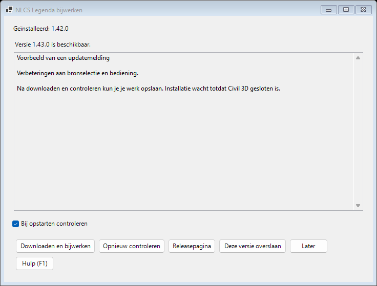

# Installeren en bijwerken

[Terug naar het project](../README.md) · [Handleiding](handleiding.md)

## Met de installer

1. Sla je werk op en sluit AutoCAD, Civil 3D en Core Console.
2. Download `NlcsLegenda-X.Y.Z.msi` bij de [laatste release](https://github.com/joligej/infracad-helper/releases/latest).
3. Voer de MSI uit. Een oudere MSI-installatie wordt bijgewerkt.
4. Start CAD opnieuw. De tab **NLCS Legenda** verschijnt in het lint.
   **Help** toont de geladen pluginversie.

De installatie is per Windows-gebruiker en vereist geen beheerder. Eén MSI bevat
de bundles voor AutoCAD/Civil 3D 2025, 2026 en 2027. De plugin staat onder
`%APPDATA%\Autodesk\ApplicationPlugins\NlcsLegenda.bundle`.

Persoonlijke instellingen staan apart in `%APPDATA%\NlcsLegenda`.
Een nieuwe versie overschrijft geen instellingen van bestaande legenda’s in DWG’s.
Verwijderen kan via Windows **Instellingen → Apps**.

De MSI is zelfondertekend als `joligej`; Windows kan een onbekende uitgever melden.
Je hoeft geen certificaat te installeren. Vergelijk de SHA-256 van je download met
`SHA256SUMS.txt` bij dezelfde release, bijvoorbeeld met `Get-FileHash` in PowerShell.
Meer uitleg staat in [Beveiliging](../SECURITY.md).

## Vanuit de plug-in

Vanaf 1.42.0 controleert de plug-in bij de eerste rustige gelegenheid na opstarten
of GitHub een nieuwere stabiele release heeft. De automatische netwerkcontrole
gaat maximaal eenmaal per dag; na een netwerkfout probeert hij het niet vaker
dan eenmaal per uur. Zonder internet blijft de huidige versie werken.

1. Open **Updates controleren** in het lint, of gebruik `NLCSLEGENDAUPDATES`.
2. Lees de wijzigingen en kies **Downloaden en bijwerken**.
3. Sla je werk op en sluit **alle** AutoCAD-, Civil 3D- en Core Console-sessies.
   Het aparte updateprogramma wacht hierop; het sluit geen programma’s voor je.
4. Wacht op **Bijwerken voltooid** en start Civil 3D opnieuw.

De geladen DLL’s worden niet vervangen terwijl CAD draait. Windows Installer
krijgt ook geen toestemming om CAD automatisch te sluiten. Als Windows toch
meldt dat een herstart nodig is, toont de updater dat; hij herstart zelf niets.
De update is pas in gebruik na een nieuwe CAD-start.

AutoCAD kan bij die eerste start **Security – Unsigned Executable File** tonen voor
`NlcsLegenda.dll`. De MSI en updater zijn ondertekend; de DLL zelf niet. Controleer
dat het om de zojuist geïnstalleerde plug-in onder
`%APPDATA%\Autodesk\ApplicationPlugins\NlcsLegenda.bundle` gaat. **Load Once**
laadt hem voor die sessie. Een blijvende vertrouwenskeuze maak je zelf volgens de
afspraken van je organisatie. De updater verlaagt `SECURELOAD` niet en voegt geen
vertrouwde mappen of certificaten toe.

**Later** stelt de automatische melding een dag uit. **Deze versie overslaan**
onderdrukt die versie; een handmatige controle blijft hem tonen. Het vinkje
**Bij opstarten controleren** geldt voor jouw Windows-gebruiker,
los van de lokale legenda-instellingen en de globale legendastandaard.
Core Console doet geen netwerkcontrole en opent geen updatevensters.

De automatische installatie is beschikbaar voor de gewone MSI-installatie per
gebruiker. Een ZIP, ontwikkelbuild, afwijkende installatie of niet ondersteunde
CAD-versie krijgt een verwijzing naar de handmatige installer. De updater vraagt
geen beheerdersrechten en installeert geen certificaat. Een onvolledig,
gewijzigd of anders ondertekend bestand wordt geweigerd.

Persoonlijke JSON-instellingen worden vóór installatie gekopieerd naar
`%LOCALAPPDATA%\NlcsLegenda\Updates\SettingsBackup` en daarna vergeleken.
De installer heeft geen toegang nodig tot je tekeningen. Bij een mislukte
installatie toont het venster de fout en de locatie van het installatielog.
Met **Opnieuw proberen** kun je verder nadat de oorzaak is verholpen.

## Handmatig met een ZIP

Kies `NlcsLegenda-2025-vX.Y.Z.zip`, `2026` of `2027` voor jouw CAD-jaargang.
Pak `NlcsLegenda.bundle` uit in `%APPDATA%\Autodesk\ApplicationPlugins` en herstart
CAD. De drie DLL’s en het updateprogramma horen bij elkaar. Combineer geen bestanden uit verschillende
versies en gebruik niet tegelijk een losse oude bundle en een MSI-installatie.

## Op een andere computer

De installer levert de plugin. Neem daarnaast zo nodig mee:

- een geëxporteerd profiel via **Profielen → Exporteren/Importeren**;
- je voorbeeldenbibliotheek; kies het nieuwe pad via **Overzicht → Voorbeeld → Bibliotheek**;
- het gebruikte lettertype, bijvoorbeeld `NLCS-ISO.ttf`, via je organisatie.

Gebruikte voorbeelden zijn ingebed in de DWG. Voor nog niet gebruikte voorbeelden
is de bibliotheek nodig. Meerdere passende varianten vereisen een eigen keuze.

## Ondersteunde hosts

De 2025- en 2026-builds gebruiken .NET 8; de 2027-build gebruikt .NET 10.
De benodigde AutoCAD-bibliotheken komen uit de host. Een aanwezige Civil 3D/Map-API
is nodig voor aanvullende KLIC-opslagvormen. Core Console is geen vervanging voor
een volledige Civil 3D-controle van AEC-proxyobjecten of Object Data.

Ontbreekt het lint of het commando? Zie [Problemen oplossen](problemen-oplossen.md).
